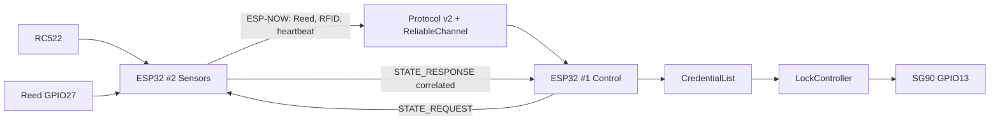

# Puerta inteligente con dos ESP32 y ESP-NOW

Firmware modular para una cerradura con un ESP32 de control y un ESP32 de
sensores. Ambos nodos se comunican localmente mediante ESP-NOW en modo WiFi STA;
ese enlace no requiere router. La telemetría AWS del controlador sí usa WiFi STA
e Internet. El controlador conserva la autorización RFID y la lógica de
cerradura. El nodo de sensores observa el Reed y el RC522.

El entregable reúne el [informe técnico y la matriz RF1–RF15](docs/Practica-4.md),
los [mockups RF15](docs/mockups-reportes.md) y la
[guía de revisión AWS](docs/revision-aws.md). Hay tráfico reciente observado en
Shadow, DynamoDB y CloudWatch, con `puerta=desconocida`; no está probado que el
publicador sea la placa ni que el Reed esté vigente. El firmware solo publica:
no aplica `desired` ni habilita el control remoto del servo. Las órdenes por voz
se demuestran con un dispositivo y actuador virtuales.

## Instalación

Requisitos: Python 3.13, PlatformIO y, para la prueba MQTT/TLS local, OpenSSL
en el `PATH` o en la variable `OPENSSL`. El cliente virtual necesita
`paho-mqtt`, fijado en `aws/virtual_device/requirements.txt`:

```powershell
python -m pip install -r aws/virtual_device/requirements.txt
```

La revisión de AWS es opcional y no modifica recursos. En este equipo el CLI no
está en el `PATH`; usar `$env:ProgramFiles\Amazon\AWSCLIV2\aws.exe` con el perfil
`puerta-inteligente` y `us-east-2`, según [revision-aws.md](docs/revision-aws.md).
Las cabeceras `esp_now_config.h` y `aws_telemetry_config.h` y el archivo
`virtual-device.local.json` son privados y están excluidos de Git.

## Ejecución y demostración simulada

Desde la raíz del repositorio, ejecutar con Python 3.13. La demostración
usa la biblioteca estándar y sustituye boto3, IoT Rules, Shadow, DynamoDB
y el servo por simuladores. Funciona sin credenciales AWS ni placas conectadas.

```powershell
python -B -m unittest discover -s tests -p 'test_aws_integration.py' -v
```

Para mostrar únicamente el recorrido de voz hasta el histórico:

```powershell
python -B tests/test_aws_integration.py LocalIntegration.test_voice_shadow_virtual_actuator_history_round_trip -v
```

La prueba genera una solicitud de Alexa, escribe `desired`, verifica que el
actuador virtual sigue quieto hasta reconciliar el Shadow, confirma en
`reported` y comprueba una fila de histórico de origen `voz`. La suite completa
incluye telemetría Reed y RFID, duplicados, comandos incompatibles y
recuperación tras una desconexión simulada.

Las [compilaciones](#entornos-compilación-y-pruebas) generan binarios locales.
Las Lambda de AWS están disponibles en el repositorio y se probaron con clientes
simulados. El adaptador MQTT/TLS del ESP32 de control está implementado y la
política, la regla y el paquete de histórico ya están desplegados; la repetición
de las pruebas C++ quedó bloqueada en este equipo por un `PermissionError` al
leer el compilador Zig de `.pio`. Consultar el estado detallado y los pendientes
en la [demo completa](docs/Practica-4.md#4-pruebas-y-validaciones).

## Arquitectura



Responsabilidades principales:

| Archivo | Responsabilidad |
|---|---|
| `shared/Protocol/src/Protocol.*` | Trama v2, serialización little endian y validación |
| `shared/Protocol/src/EspNowLink.*` | WiFi STA, peer unicast, callbacks y cola acotada |
| `shared/Protocol/src/ReliableChannel.*` | Sesiones, ACK, reintentos, deduplicación y estadísticas |
| `firmware/esp32_sensors/src/SensorLinkManager.cpp` | Publicación del Reed/RFID y respuestas de estado |
| `firmware/esp32_control/src/ControlLinkManager.cpp` | Recepción, vigencia del sensor y confirmación de bloqueo |
| `LockController`, `CredentialList`, `LockServo` | Reglas, autorización y PWM, respectivamente |

`SerialLink` permanece disponible para pruebas y diagnóstico aislado. Los
entornos normales usan `EspNowLink`.

## Hardware fijo

ESP32 #1 usa el SG90 en GPIO13. `locked` corresponde a 0° y `unlocked` a 90°.
El firmware no mueve el servo durante el arranque y no dispone de sensor para
confirmar la posición mecánica real.

| RC522 / Reed | ESP32 #2 |
|---|---|
| RC522 SS | GPIO21 |
| RC522 SCK | GPIO18 |
| RC522 MOSI | GPIO23 |
| RC522 MISO | GPIO19 |
| RC522 RST | GPIO22 |
| RC522 alimentación | 3.3 V |
| Reed | GPIO27 con `INPUT_PULLUP` |

En el Reed, LOW significa `closed`, HIGH significa `open` y cada lectura debe
permanecer estable 100 ms. La primera lectura es `unknown` durante esa ventana.

## Credenciales y reglas

| UID | Resultado | Identificador |
|---|---|---|
| `39 61 D7 06` | `Action::UNLOCK`, 90° | `card-1` |
| `9C 31 8B 06` | `Action::UNLOCK`, 90° | `keyfob-1` |

Un UID desconocido se rechaza. Ambas credenciales se rechazan en
`Mode::BLOCKED`. Ninguna credencial bloquea ni alterna la cerradura. Una
presentación repetida cuando ya está desbloqueada produce `no_change`, sin PWM
adicional ni reinicio del autocierre. La autenticación basada en UID es clonable
y no debe tratarse como un control de acceso comercial.

## Configuración local de ESP-NOW

Cada firmware incluye `include/esp_now_config.example.h`. Copiarlo como
`include/esp_now_config.h`; ese nombre está ignorado por Git.

```powershell
Copy-Item firmware/esp32_control/include/esp_now_config.example.h firmware/esp32_control/include/esp_now_config.h
Copy-Item firmware/esp32_sensors/include/esp_now_config.example.h firmware/esp32_sensors/include/esp_now_config.h
```

En cada copia se configura la MAC **WiFi STA del otro ESP32**, el mismo canal y
la política de cifrado:

```cpp
#define ESPNOW_PEER_CONFIGURED 1
#define ESPNOW_PEER_MAC {0x00, 0x00, 0x00, 0x00, 0x00, 0x00}
#define ESPNOW_CHANNEL 1
#define ESPNOW_ENCRYPTION_ENABLED 0
```

Los ceros son marcadores inválidos y deben reemplazarse. La MAC base observada
previamente para el ESP32 #2, `04:B2:47:84:13:8C`, todavía debe compararse con
`localStaMac` en el monitor serie; no se incorpora como peer definitivo hasta
verificar que sea la MAC WiFi STA. La MAC del ESP32 #1 se obtiene del mismo modo.
El comando `link status` muestra:

- `localStaMac`, `peerMac`, canal e inicialización;
- enlace online/offline y cifrado;
- recepciones, envíos, tramas inválidas, fuentes no autorizadas, desbordamientos,
  reintentos y reintentos agotados.

Sin una MAC unicast válida el transporte no inicia y el sistema queda sin
movimientos automáticos. El canal permitido es 1–14 y debe coincidir en ambos
nodos. Cuando ESP32 #1 se conecte a un punto de acceso para AWS, ESP-NOW deberá
usar el canal efectivo de esa red; no se puede mantener un canal fijo distinto.

### Seguridad del enlace

ESP-NOW permite cifrado unicast con PMK y LMK. Los ejemplos contienen únicamente
arreglos nulos, nunca claves reales. Para cifrar, definir localmente PMK y LMK de
16 bytes y activar `ESPNOW_ENCRYPTION_ENABLED`. La salida
`encryption=LAB_UNENCRYPTED` identifica de forma explícita el modo provisional
sin cifrado. Validar la MAC de origen evita peers accidentales, pero no aporta
autenticación criptográfica.

## Protocolo v2

La trama mide exactamente 34 bytes. No se transmite una estructura C++ ni datos
dinámicos. Los enteros de 32 bits se codifican little endian.

| Offset | Bytes | Campo |
|---:|---:|---|
| 0 | 1 | versión (`2`) |
| 1 | 1 | tipo |
| 2 | 4 | sesión de arranque del emisor |
| 6 | 4 | secuencia del emisor |
| 10 | 1 | `doorState` |
| 11 | 1 | longitud UID |
| 12 | 10 | UID, con relleno cero |
| 22 | 4 | sesión correlacionada |
| 26 | 4 | secuencia correlacionada |
| 30 | 4 | uptime del emisor |

Tipos: `REED_STATE`, `RFID_PRESENTED`, `HEARTBEAT`, `ACK`, `STATE_REQUEST` y
`STATE_RESPONSE`. Se validan tamaño, versión, tipo, sesión y secuencia no nulas,
enumeraciones, longitud UID 4/7/10, relleno y coherencia de cada tipo. El
transporte también exige que la MAC origen coincida con el peer configurado.
Una trama rechazada no actualiza la vigencia del Reed ni ejecuta acciones.

Cada arranque genera una sesión aleatoria no nula. Una nueva sesión remota
invalida el Reed anterior y retira mensajes pendientes de la sesión previa. Se
mantiene un historial acotado de sesiones retiradas para rechazar tráfico tardío.
Las secuencias duplicadas se confirman de nuevo, pero solo se entregan una vez;
las más antiguas no sobrescriben estados recientes.

Los mensajes fiables esperan un ACK de aplicación 200 ms, realizan como máximo
tres intentos y ocupan una de cuatro posiciones pendientes. La recepción ESP-NOW
usa una cola de seis tramas protegida entre el callback WiFi y `loop()`. Los
desbordamientos y descartes quedan en estadísticas. Un ACK indica recepción
válida, no autorización RFID ni movimiento del servo.

## Flujo de sensores

ESP32 #2 transmite la primera lectura estable del Reed, cada cambio estable,
cada presentación RFID válida y un heartbeat cada 1000 ms. Antes de estabilizar
el Reed, un heartbeat puede llevar `unknown`, que nunca se interpreta como
`closed`. Una solicitud `STATE_REQUEST` recibe un `STATE_RESPONSE` con la sesión
y secuencia originales. La autorización de credenciales no existe en este nodo.

En el entorno normal los UID permanecen ocultos en USB. La cola y los tres
intentos limitan la permanencia de una presentación RFID no confirmada.

## Vigencia y confirmación previa al bloqueo

ESP32 #1 marca el sensor offline tras 3000 ms sin tráfico válido. Tres intervalos
de heartbeat permiten tolerar dos pérdidas consecutivas antes de invalidar el
Reed. Un heartbeat repetido con el mismo estado conserva vigencia sin reiniciar
el temporizador de autocierre.

Cuando vence el autocierre, `LockController` solicita bloqueo a
`ControlLinkManager`. La máquina de estados no bloqueante:

1. envía un `STATE_REQUEST` y conserva su sesión, secuencia, peer y plazo de 750 ms;
2. cancela si aparece una puerta abierta, cambia la sesión o vence el plazo;
3. acepta únicamente un `STATE_RESPONSE` correlacionado, oportuno y `closed`;
4. actualiza el controlador mediante su interfaz pública y emite entonces la
   orden `Action::LOCK`.

Puerta `open`, `unknown`, dato obsoleto o respuesta antigua impiden el movimiento.
La misma entrada `requestLock()` debe usarse para una futura orden de Alexa. Este
procedimiento reduce el uso de lecturas antiguas, pero no garantiza seguridad
mecánica ni detecta obstáculos o fallos del pestillo.

## Entornos, compilación y pruebas

Dependencias fijadas: PlatformIO `espressif32@7.1.3`, Arduino-ESP32
`4.20017.260907` (core 2.0.17), ESP32Servo 0.13.0 y MFRC522 1.4.12.

```powershell
$pio = "$env:USERPROFILE\.platformio\penv\Scripts\platformio.exe"
& $pio run -d firmware/esp32_control -e esp32dev -e simulation -e calibration
& $pio run -d firmware/esp32_sensors -e esp32dev -e diagnostic
& "$env:USERPROFILE\.platformio\penv\Scripts\python.exe" tests/run_tests.py
```

Entornos disponibles:

| Nodo | Entorno | Uso |
|---|---|---|
| Control | `esp32dev` | ESP-NOW y servo normal |
| Control | `simulation` | lógica sin PWM ni radio |
| Control | `calibration` | movimiento físico explícito 0°/90° |
| Sensores | `esp32dev` | ESP-NOW con UID oculto |
| Sensores | `diagnostic` | ESP-NOW y UID visible solo por USB |

Línea base: **85 pruebas aprobadas, 0 fallidas, 8 binarios de prueba**, con
casos de trama inválida, MAC, ACK, reintentos, colas, duplicados, orden,
sesiones, heartbeat, timeout, RFID y confirmación previa. Tras añadir la
telemetría se documentaron **91/91 pruebas C++ y 6/6 compilaciones**; en este
equipo no fue posible repetir la suite C++ por el `PermissionError` indicado
arriba. No se han modificado los firmwares en este cierre.

## Carga y prueba física integrada en Windows

El repositorio no incluye registro de la carga ni salida del monitor serie de
las placas actualizadas. Para repetirla, conectar una placa por vez, identificar
su COM en VS Code/PlatformIO y usar:

```powershell
& $pio run -d firmware/esp32_control -e esp32dev -t upload --upload-port COM_CONTROL
& $pio device monitor --port COM_CONTROL --baud 115200

& $pio run -d firmware/esp32_sensors -e esp32dev -t upload --upload-port COM_SENSORS
& $pio device monitor --port COM_SENSORS --baud 115200
```

Procedimiento recomendado:

1. cargar cada placa sin montar el servo en el mecanismo y anotar `localStaMac`;
2. confirmar si `04:B2:47:84:13:8C` coincide con la STA de sensores;
3. completar ambos `esp_now_config.h` con las MAC opuestas y el mismo canal;
4. recompilar y cargar individualmente; comprobar `initialized=yes` y luego
   `link=online` en ambos monitores;
5. verificar `unknown`, `open` y `closed` del Reed antes de conectar el servo;
6. presentar tarjeta, llavero y un UID desconocido, observando una sola decisión;
7. probar `blocked`, repeticiones, pérdida de energía del nodo de sensores y su
   reinicio independiente;
8. con alimentación de 5 V adecuada y GND común, probar desbloqueo y autocierre,
   incluida apertura durante `STATE_REQUEST` y ausencia de respuesta;
9. registrar resultados reales; la compilación no demuestra alcance de radio,
   movimiento, posición, fuerza ni seguridad del montaje.

## Estado AWS y pendientes

ESP32 #1 es el único nodo previsto para AWS. `AwsTelemetry` traduce los estados
internos a `puerta`, `cerradura`, `modo` y `autocierre_s` en Shadow y los eventos
a `tipo`, `origen`, `resultado` y sus atributos en DynamoDB. El
[contrato y las configuraciones](docs/Practica-4.md#27-contrato-del-device-shadow)
mantienen los nombres externos en español.

La verificación del 24/11/2026 confirmó Shadow actualizado, lecturas `edge`
recientes cada ~30 s en DynamoDB e invocaciones de la Lambda de histórico. La
política v2 y la regla están restringidas a la publicación del Thing. El estado
publicado es `desconocido` y el `desired` existente sigue sin aplicarse: el
firmware no se suscribe a `delta` y el servo permanece aislado del control
remoto. Cualquier habilitación futura del bloqueo remoto debe pasar por
`ControlLinkManager::requestLock()` y esperar la confirmación o el vencimiento
antes de responder en Shadow.

Quedan por demostrar: la identidad del publicador desde el monitor serie, un
Reed vigente, las frases de Alexa, la repetición real de `eventId` y un mensaje
inválido en AWS, la deduplicación y la latencia de extremo a extremo. Persisten
riesgos de clonación RFID, interferencia o pérdida de radio, colas agotadas,
reinicios, ausencia de realimentación del servo y posible atasco mecánico. Deben
evaluarse con ambos ESP32 y el montaje real.
