# Informe Final Práctica 4 — Grupo 7

**Universidad Católica Boliviana** · Carrera Ingeniería de Sistemas · Asignatura Internet de las Cosas (SIS-234) · Periodo 2-2026

**Actividad:** Práctica 4 · **Proyecto:** Sistema distribuido de puerta inteligente con ESP32, ESP-NOW, AWS IoT Core y Alexa

**Grupo 7** · Jesús Ariel Mamani Gutiérrez · Leonardo Koller · Luis Felipe Velasco

**Repositorio:** https://github.com/feliLuis/practica4PuertaInteligente · **Rama de trabajo:** `feat/esp32-sensores`

**Informe principal:** `docs/Informe-Final-Practica-4-Grupo-7.md` · **Fecha:** 24 de noviembre de 2026

---

## Resumen ejecutivo

El prototipo distribuye la adquisición y el control entre dos ESP32. El nodo de sensores captura el contacto Reed y las presentaciones RC522 y las transmite por ESP-NOW con una trama v2 de 34 bytes, sesiones por arranque, ACK de aplicación y deduplicación. El nodo de control mantiene la lista de credenciales, la máquina de estados del cerrojo, el temporizador de autocierre y el actuador SG90. Sobre ese núcleo se incorporó un adaptador de telemetría que publica por MQTT sobre TLS mutuo en AWS IoT Core: eventos individuales, lecturas periódicas y el estado reportado del Device Shadow.

La verificación acumula **91/91 pruebas C++**, **25/25 pruebas Python** y **6/6 compilaciones PlatformIO** correspondientes a la versión de cierre de la telemetría; la repetición local de C++ al cierre no fue posible por un bloqueo del compilador portátil, por lo que ese resultado se conserva como registro histórico y no como una ejecución nueva. La consulta en solo lectura del proyecto AWS del 24/11/2026 confirmó el Shadow en versión 28, 31 lecturas almacenadas entre las 21:44:18Z y las 22:01:46Z, invocaciones recientes de la Lambda de histórico, la política IoT v2 limitada a `Connect` y publicación, la regla activa con proyección explícita y el TTL habilitado en `ChapaHistory`. El intervalo `ingresoTs − ts` observado fue de 0,695 a 2,413 s.

El estado reportado vigente es `puerta=desconocida` y `cerradura=desconocida`, con `modo=automatico` y `autocierre_s=10`. El firmware de campo es de **solo publicación**: no suscribe `update/delta`, no aplica `desired` y no mueve el servo por una orden de Alexa. La persistencia de 31 lecturas y la compatibilidad del formato con el publicador no identifican al emisor ni prueban una lectura Reed vigente. Las órdenes por voz, los cambios de parámetros y la deduplicación frente a mensajes reales están verificados únicamente con el dispositivo y el actuador virtuales. La actuación física remota y las mediciones de latencia extremo a extremo permanecen sin verificar.

## Índice

- [1. Caso de uso y requerimientos](#1-caso-de-uso-y-requerimientos)
- [2. Análisis y diseño](#2-análisis-y-diseño)
  - [2.1 Diagrama de bloques](#21-diagrama-de-bloques)
  - [2.2 Arquitectura del sistema](#22-arquitectura-del-sistema)
  - [2.3 Circuito electrónico](#23-circuito-electrónico)
  - [2.4 Diagramas de clases](#24-diagramas-de-clases)
  - [2.5 Diagramas de secuencia](#25-diagramas-de-secuencia)
  - [2.6 Lógica de control](#26-lógica-de-control)
  - [2.7 Device Shadow](#27-device-shadow)
  - [2.8 Modelo de datos de DynamoDB](#28-modelo-de-datos-de-dynamodb)
  - [2.9 IoT Rules y funciones Lambda](#29-iot-rules-y-funciones-lambda)
  - [2.10 Skill de Alexa](#210-skill-de-alexa)
  - [2.11 Mockups de reportes](#211-mockups-de-reportes)
- [3. Desarrollo e implementación](#3-desarrollo-e-implementación)
- [4. Pruebas y validaciones](#4-pruebas-y-validaciones)
- [5. Resultados](#5-resultados)
- [6. Conclusiones](#6-conclusiones)
- [7. Recomendaciones](#7-recomendaciones)
- [8. Anexos](#8-anexos)
- [Matriz de trazabilidad](#matriz-de-trazabilidad)

---

## 1. Caso de uso y requerimientos

### 1.1 Problema, contexto y alcance

Una puerta de acceso a una vivienda o laboratorio puede quedar abierta por distracción, permitir el ingreso con una credencial no autorizada y no ofrecer evidencia de lo ocurrido cuando no hay una persona supervisando el sitio. El sistema propuesto resuelve tres necesidades concretas: conocer el estado de la puerta sin estar frente a ella, autorizar el desbloqueo mediante una credencial RFID y conservar un histórico consultable de lecturas, accesos y movimientos.

El usuario interactúa por tres vías: la puerta y su cerradura, la credencial RFID y la voz mediante Alexa. El prototipo cubre la captura local, la decisión automática en el Edge, la publicación de telemetría, el almacenamiento en DynamoDB y la consulta por voz del estado reportado. No cubre la instalación mecánica definitiva, la alimentación redundante, la gestión de identidades de acceso reales ni la actuación física de una orden remota.

El límite entre prototipo académico y producto comercial es sustancial. El montaje usa un SG90 sin realimentación de posición del pestillo, UID de tarjeta y llavero registrados en firmware y cifrado ESP-NOW desactivado en la configuración de laboratorio. Estas decisiones son aceptables para demostrar arquitectura y lógica, pero no constituyen un control de acceso seguro: un UID es clonable, un PWM enviado no demuestra que el cerrojo se haya movido y la ausencia de cifrado expone el enlace local.

### 1.2 Evolución de la Práctica 3 a la Práctica 4

| Dimensión | Práctica 3 | Práctica 4 |
|---|---|---|
| Comunicación local | Enlace serie inicial entre placas | ESP-NOW unicast con protocolo v2, sesiones, ACK, reintentos y deduplicación |
| Sensado | Reed y RC522 en etapa de integración | Reed con debounce de 100 ms y vigencia de 3 s; RC522 con supresión de repeticiones de 1,5 s |
| Actuación | Servo y lógica básica de credenciales | Autocierre en el Edge con confirmación de estado correlacionada por ESP-NOW antes de bloquear |
| Nube | Modelo Alexa y backend inicial con errores observados | Regla IoT activa, Lambda de histórico con validación y deduplicación, tablas DynamoDB y Shadow clásico |
| Histórico | No consolidado | `ChapaHistory` con `thingName`/`eventKey`, TTL de 30 días y origen de cada evento |
| Voz | Consultas y vinculación incipientes | Modelo `es-MX` con 15 intents, resolución `userId`→Thing, vigencia de snapshot y control de versión de `desired` |
| Seguridad | Política IoT con ARN incompatibles | Política v2 de solo publicación limitada al Thing y dos tópicos |
| Estado del actuador | Estimación implícita | `cerradura` estimada a partir del comando PWM, explícitamente no confirmada mecánicamente |

### 1.3 Justificación de componentes y arquitectura

- **Sensor magnético Reed.** Es una entradas binaria de bajo costo y consumo que indica si la hoja de la puerta está cerrada. Su estado es una condición necesaria para autorizar un bloqueo; no informa la posición del pestillo. El firmware exige 100 ms de estabilidad y trata la ausencia de lecturas durante 3 s como `desconocida` (`firmware/esp32_sensors/include/config.h:16-23`, `firmware/esp32_control/include/config.h:19-25`).
- **RFID RC522.** Permite demonstrar autorización sin contacto con tarjeta y llavero. Se conserva en el nodo de sensores para que el controlador reciba únicamente el UID y el estado de puerta asociado a la presentación; el histórico registra `credentialId`, nunca el UID crudo (`firmware/esp32_sensors/src/RfidReader.cpp:46-75`).
- **Servomotor SG90.** Representa el mecanismo de cierre con dos posiciones configuradas: 0° para bloqueado y 90° para desbloqueado. La librería confirma la emisión de PWM, no el recorrido mecánico; por ello el estado publicado se denomina estimación (`firmware/esp32_control/src/LockServo.cpp:17-34`).
- **Dos ESP32.** Separar sensado y control evita que la conexión WiFi/MQTT del controlador interrumpa la adquisición local, reduce el acoplamiento entre sensores y nube y permite que las reglas de seguridad se ejecuten en el nodo que gobierna el actuador.
- **ESP-NOW.** Proporciona comunicación local sin router ni Internet, con latencia baja y sin dependencia del servicio cloud para decisiones inmediatas. La trama fija de 34 bytes y el canal compartido con el AP son restricciones verificadas en código (`shared/Protocol/src/Protocol.cpp:32-33`, `shared/Protocol/src/EspNowLink.cpp:12-21`).
- **AWS IoT Core, DynamoDB y Alexa.** IoT Core aporta transporte MQTT/TLS y Device Shadow; una IoT Rule projecciona y encamina los eventos; Lambda valida y persiste; DynamoDB conserva el histórico y los vínculos usuario–Thing; Alexa ofrece la interfaz de voz y escribe `desired` cuando se prueba con el actuador virtual.
- **Restricciones eléctricas y de seguridad.** RC522 a 3,3 V, Reed con `INPUT_PULLUP`, servo con fuente regulada de 5 V y masa común. El servo se aísla durante pruebas remotas; el cifrado ESP-NOW y el reemplazo de UID de prototipo son requisitos previos a cualquier uso real.

### 1.4 Requerimientos funcionales RF1–RF15

| ID | Descripción y criterio de aceptación | Componente responsable | Referencia al código | Prueba asociada | Evidencia | Estado |
|---|---|---|---|---|---|---|
| RF1 | Capturar Reed y RFID; aceptar lectura estable y presentación 4/7/10 bytes, sin UID crudo en telemetría | `DoorSensor`, `RfidReader` | [`DoorSensor.cpp:20-37`](../firmware/esp32_sensors/src/DoorSensor.cpp#L20-L37), [`RfidReader.cpp:46-75`](../firmware/esp32_sensors/src/RfidReader.cpp#L46-L75) | PU-01, PF-01 | E03, E05 | Implementado con validación parcial: probado con sustitutos; el estado publicado reciente es `desconocida` |
| RF2 | Reportar sensor y actuador por cambio y cada 30 s | `AwsTelemetry`, `AwsPayload` | [`AwsTelemetry.cpp:18-24`](../firmware/esp32_control/src/AwsTelemetry.cpp#L18-L24), `:198-224` | PA-02, PNF-04 | E11, E17, E18 | Implementado con validación parcial: 31 lecturas a ~30 s; emisor no atribuido por monitor serie |
| RF3 | Aplicar `delta` y confirmar en `reported` | Consumer de Shadow (no implementado en campo), `ControlLinkManager` | [`AwsTelemetry.cpp:132-162`](../firmware/esp32_control/src/AwsTelemetry.cpp#L132-L162), [`ControlLinkManager.cpp:16-32`](../firmware/esp32_control/src/ControlLinkManager.cpp#L16-L32) | PC-03, PV-02 | E09, E10 | No cumple en firmware de campo; verificado mediante simulación con actuador virtual |
| RF4 | Consultar el sensor del Thing por voz en español | `EstadoPuertaIntent`, `handle_intent` | [`chapa-skill-alexa/lambda_function.py:139-142`](../aws/lambda/chapa-skill-alexa/lambda_function.py#L139-L142) | PU-05, PV-01 | E19, E22 | Implementado con validación parcial: modelo compilado y lógica simulada; sin invocación reciente en Alexa Console |
| RF5 | Ordenar apertura/cierre por voz mediante `desired` con ID y vencimiento | Lambda Alexa, actuador virtual | [`lambda_function.py:157-173`](../aws/lambda/chapa-skill-alexa/lambda_function.py#L157-L173) | PU-05, PV-02 | E20, E22 | Verificado mediante simulación; actuación física fuera de alcance |
| RF6 | Consultar el estado del actuador por voz distinguiendo `desconocida` | `EstadoCerraduraIntent` | [`lambda_function.py:143-146`](../aws/lambda/chapa-skill-alexa/lambda_function.py#L143-L146) | PU-05 | E19, E22 | Implementado con validación parcial; `reported.cerradura=desconocida` vigente |
| RF7 | Vincular usuario–Thing y persistir entre sesiones | `AlexaThingBindings`, `bind_user` | [`lambda_function.py:73-75`](../aws/lambda/chapa-skill-alexa/lambda_function.py#L73-L75), `:102-120` | PU-05, PA-04 | E07, E20 | Implementado con validación parcial: tabla activa y alta simulada; falta persistencia real entre sesiones |
| RF8 | Resolver por `userId` y orientar si falta vínculo | `bound_thing`, `lambda_handler` | [`lambda_function.py:213-224`](../aws/lambda/chapa-skill-alexa/lambda_function.py#L213-L224) | PU-05 | E20 | Verificado mediante simulación con dos usuarios; sin prueba en Alexa Console |
| RF9 | Comprobar existencia, cambiar y eliminar vínculo | `bind_user`, `DesvincularIntent` | [`lambda_function.py:102-120`](../aws/lambda/chapa-skill-alexa/lambda_function.py#L102-L120), `:217-221` | PU-05 | E20 | Verificado mediante simulación con sustituto de DynamoDB |
| RF10 | IoT Rule invoca Lambda con datos del objeto | `ChapaEventosRule` | [`iot-rule.proposed.json`](../aws/config/iot-rule.proposed.json), [`deployed-sanitized.json`](../aws/config/deployed-sanitized.json) | PA-01, PA-03 | E12, E13, E15 | Cumple y verificado: regla activa e invocaciones observadas en CloudWatch |
| RF11 | Validar, enriquecer y almacenar lecturas y eventos | `chapa-almacenar-evento` | [`lambda_function.py:44-86`](../aws/lambda/chapa-almacenar-evento/lambda_function.py#L44-L86), `:95-123` | PU-04, PA-05 | E14, E15, E16, E17 | Implementado con validación parcial: 31 filas reales; descarte y deduplicación solo con sustitutos |
| RF12 | Historial de movimientos con su origen | `AwsPayload::event`, Lambda de histórico | [`AwsTelemetryPayload.cpp:31-57`](../firmware/esp32_control/src/AwsTelemetryPayload.cpp#L31-L57), `:70-83` | PU-04, PA-05 | E16, E17, E18 | Implementado con validación parcial: filas recientes son `lectura/edge`; voz verificada en simulación |
| RF13 | Lógica automática de autocierre y justificación Edge/Nube | `LockController`, `ControlLinkManager` | [`LockController.cpp:64-75`](../firmware/esp32_control/src/LockController.cpp#L64-L75), `:181-194`; [`ControlLinkManager.cpp:22-32`](../firmware/esp32_control/src/ControlLinkManager.cpp#L22-L32) | PL-01, PL-02, PC-03 | E06, E21 | Verificado mediante simulación con reloj y radio simulados; medición física pendiente |
| RF14 | Reportar, consultar y modificar modo y parámetros por voz | Shadow `reported`, `CambiarModoIntent`, `CambiarAutocierreIntent` | [`AwsTelemetryPayload.cpp:91-98`](../firmware/esp32_control/src/AwsTelemetryPayload.cpp#L91-L98), [`lambda_function.py:174-187`](../aws/lambda/chapa-skill-alexa/lambda_function.py#L174-L187) | PU-05, PV-03 | E09, E10, E19 | Implementado con validación parcial: `automatico`/10 s reportados; cambio verificado con dispositivo virtual |
| RF15 | Mockups de reportes basados en DynamoDB | `docs/mockups-reportes.md` | [mockups-reportes.md](mockups-reportes.md) | Diseño, no prueba de ejecución | E16, E17 | Cumple como entregable de diseño; muestra real anonimizada incorporada |

### 1.5 Requerimientos no funcionales

| RNF | Objetivo y justificación | Método de medición | Resultado observado | Veredicto |
|---|---|---|---|---|
| Estabilidad | ≥10 min de operación continua sin reinicio ni bloqueo; evita pérdida de eventos durante ensayos largos | Ventana de publicaciones y monitor serie | 31 publicaciones entre 21:44:18Z y 22:01:46Z (~17,5 min) sin reinicios observados en esa ventana; falta tráfico mixto voz/autocierre | Verificación parcial |
| Exactitud de medición | Reed concordante con posición observada en serie declarada de ciclos; RFID con aciertos, omisiones y repeticiones por presentación dentro de rango declarado | Ciclos supervisados y conteo por UID seudonimizado | Sin muestra declarada ni medición física; estado reciente `desconocida` | No verificado |
| Tiempo de respuesta | ≤3 s de solicitud por voz a movimiento | Reloj común desde Alexa Console hasta servo | Solo flujo lógico simulado; Lambda de Alexa sin invocaciones recientes | No verificado |
| Frecuencia de reporte | Cambio discreto ≤1 s; respaldo cada 30 s | Intervalos en Shadow e histórico | Respaldo ~30 s en 31 lecturas; plazo de 1 s no medido | Verificación parcial |
| Reconexión y sincronización | Restaurar WiFi/MQTT y aplicar `desired` válido pendiente | Corte real de red y observación de versión/expiración | Reconciliación simulada; `desired` real sigue pendiente en Shadow | No verificado en campo |
| Integridad del almacenamiento | ≥99 % de eventos válidos únicos publicados persistidos, con descarte de inválidos | Conteo independiente de IDs publicados frente a filas | 31 IDs únicos almacenados; sin denominador completo ni repetición real | No verificado |
| Latencia de almacenamiento | ≤5 s desde marca temporal de la regla hasta ingreso a DynamoDB | `ingresoTs − ts` en filas reales | 0,695–2,413 s en 31 filas; no incluye sensor ni espera offline | Verificado para ese tramo |
| Tiempo de respuesta de la lógica automática | Medir desde vencimiento del temporizador con Reed vigente hasta acción | Reloj simulado y posterior medición física | Lógica probada con reloj simulado; segundos configurados (10) no son latencia medida | Verificado mediante simulación |
| Operación sin conexión | RFID, interbloqueos y autocierre activos con Reed vigente; cola acotada | Corte de Internet con enlace ESP-NOW activo | Controlador probado con lecturas simuladas; cola de 24 eventos en RAM; corte real pendiente | Verificación parcial |
| Costo | Estimar consumo mensual de IoT, Lambda, DynamoDB y beneficios aplicables | Fórmula por operaciones y tarifas de referencia | Estimación de USD 0,52/mes antes de créditos; consumo real no validado | Estimado, no medido |
| Seguridad y protección de secretos | TLS, plantillas sin secretos, roles documentados, UID revisado antes de uso real | Revisión de `.gitignore`, exportación sanitizada y configuración | Política v2 y regla restrictivas; cabecera privada excluida; cifrado ESP-NOW desactivado; UID de prototipo presentes | Verificación parcial |

---

## 2. Análisis y diseño

### 2.1 Diagrama de bloques

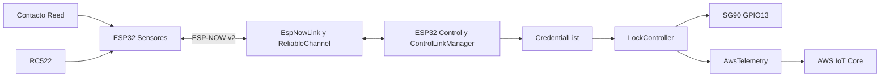

El ESP32 de sensores no decide movimientos: publica lecturas y responde a solicitudes de estado. El ESP32 de control concentra autorización, temporizador, PWM y publicación. Las responsabilidades nube se limitan a transporte, Shadow, reglas, persistencia y consultas.

### 2.2 Arquitectura del sistema

**Vista de despliegue**

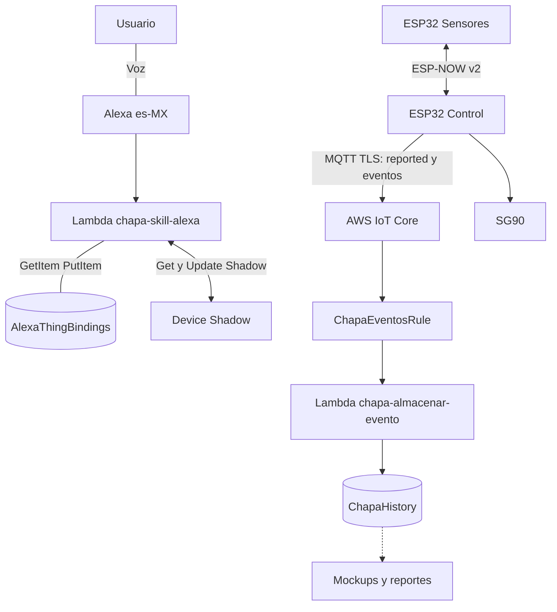

**Vista de componentes**

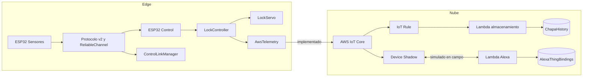

**Leyenda.** Las líneas continuas desde `AwsTelemetry` hacia IoT Core, Shadow, la regla y DynamoDB están implementadas y observadas en AWS. La interacción Alexa↔Shadow↔actuador se verificó con un Thing y un actuador virtuales; en el firmware desplegado no existe suscripción `update/delta`, por lo que no se representa como flujo físico operativo. El vínculo Alexa con `AlexaThingBindings` existe en el despliegue, pero las sesiones reales no fueron probadas.

### 2.3 Circuito electrónico

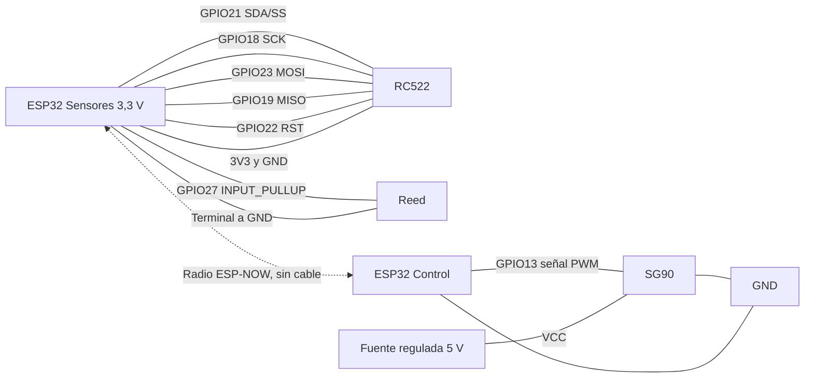

| Componente | Función | Alimentación / interfaz | Fuente verificable |
|---|---|---|---|
| ESP32-WROOM #2 | Adquisición Reed/RFID y enlace local | 3,3 V; WiFi STA + ESP-NOW | [`esp32_sensors/include/config.h`](../firmware/esp32_sensors/include/config.h#L9-L26) |
| RC522 | Lectura de UID | 3,3 V; SPI en GPIO18/19/21/22/23 | [`RfidReader.cpp:12-19`](../firmware/esp32_sensors/src/RfidReader.cpp#L12-L19) |
| Reed | Estado abierta/cerrada | GPIO27 con `INPUT_PULLUP`, LOW=cerrado | [`DoorSensor.cpp:10-24`](../firmware/esp32_sensors/src/DoorSensor.cpp#L10-L24) |
| ESP32 #1 | Control, lógica y telemetría | 3,3 V; WiFi STA + ESP-NOW + MQTT/TLS | [`esp32_control/include/config.h`](../firmware/esp32_control/include/config.h#L13-L29) |
| SG90 | Actuador de demostración | 5 V regulados, señal GPIO13, GND común | [`LockServo.cpp:11-34`](../firmware/esp32_control/src/LockServo.cpp#L11-L34) |

No se declaran corrientes, longitudes de cable ni valores de resistencia porque no están documentados en el repositorio. La masa común entre placas y actuador es necesaria para la señal PWM; el canal ESP-NOW debe coincidir con el canal efectivo del AP cuando el controlador se conecte a WiFi.

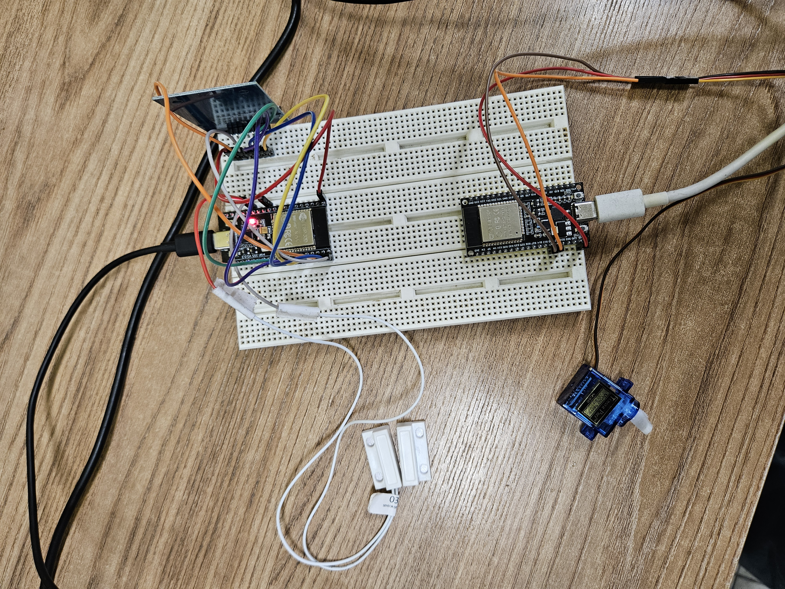

*Figura 1. Montaje general del sistema distribuido (E01).*

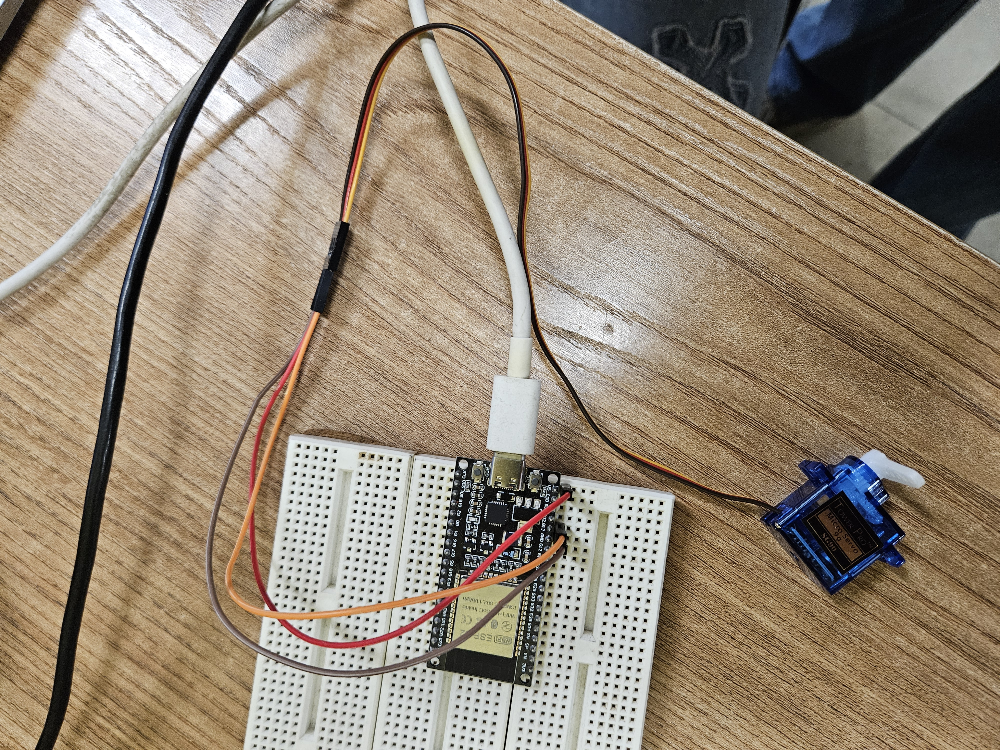

*Figura 2. Detalle del actuador y su acople al montaje (E02). No confirma fuerza ni posición del pestillo.*

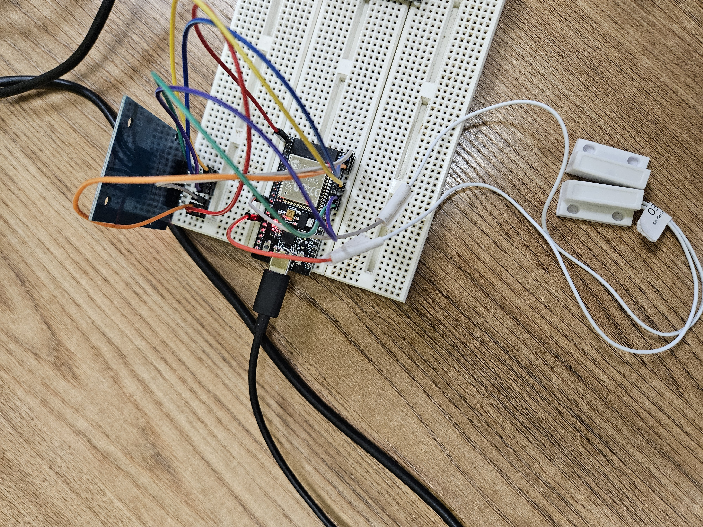

*Figura 3. Nodo de sensores con RC522 y contacto Reed (E03).*

### 2.4 Diagramas de clases

**Firmware ESP32 Control**

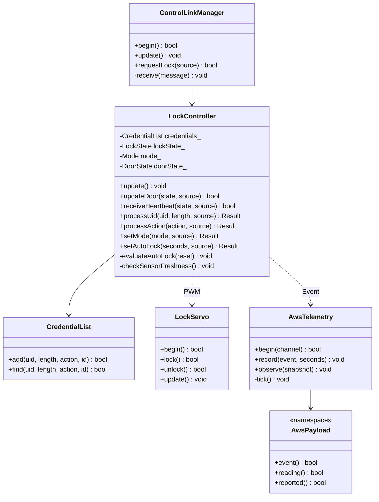

`LockController` es la autoridad de estado; `LockServo` solo confirma emisión de PWM; `AwsTelemetry` copia eventos sin retroalimentar la lógica.

**Firmware ESP32 Sensores**

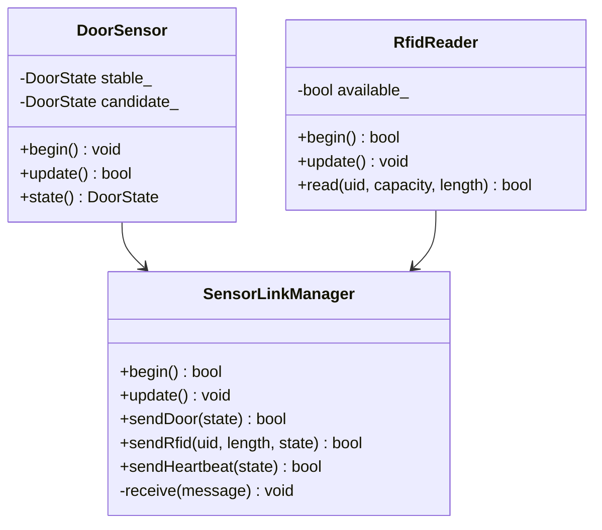

`DoorSensor` estabiliza la lectura; `RfidReader` filtra repeticiones y longitudes inválidas; `SensorLinkManager` traduce eventos a tramas.

**Módulos compartidos de comunicación**

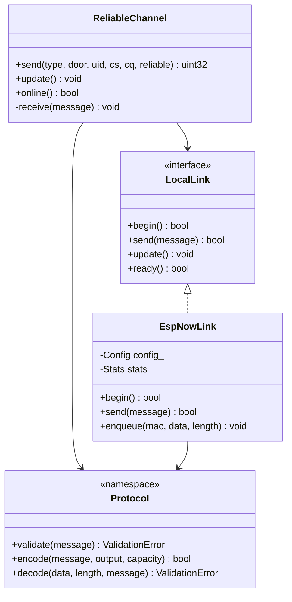

`Protocol` define el contrato binario; `EspNowLink` gestiona radio, MAC autorizada y cola de seis tramas; `ReliableChannel` añade sesiones, ACK de 200 ms, tres intentos y cuatro ranuras pendientes.

**Lambda de almacenamiento (módulos y funciones reales)**

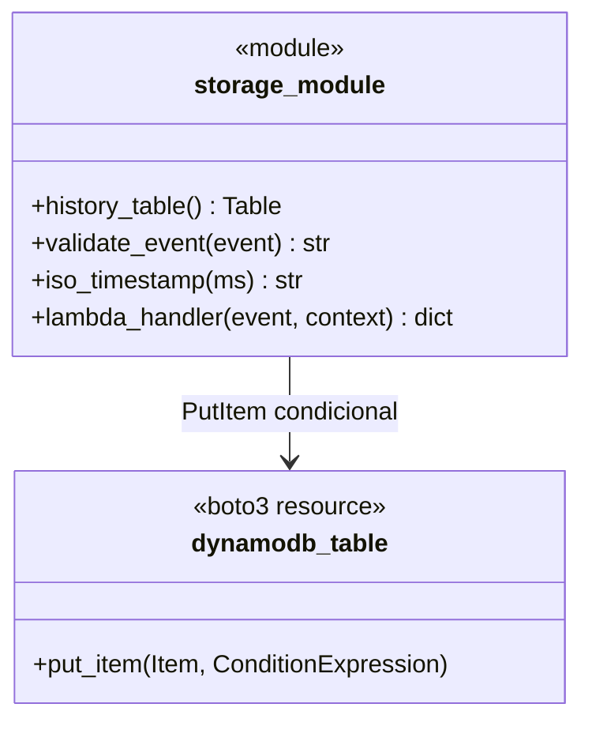

**Lambda de Alexa (módulos y funciones reales)**

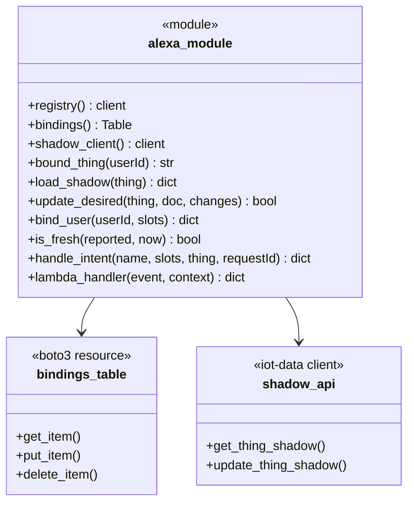

### 2.5 Diagramas de secuencia

**1. Consulta del estado de la puerta desde Alexa**

```mermaid
sequenceDiagram
    actor U as Usuario
    participant A as Alexa
    participant L as Lambda Alexa
    participant B as AlexaThingBindings
    participant S as Shadow
    U->>A: Cómo está la puerta
    A->>L: EstadoPuertaIntent y userId
    L->>B: GetItem consistente por userId
    B-->>L: thingName
    L->>S: GetThingShadow
    S-->>L: reported y reportado_ms
    alt Snapshot vigente y puerta válida
        L-->>A: La puerta está cerrada/abierta
    else Sin dato vigente
        L-->>A: Todavía no tengo una lectura reciente
    end
    Note over A,S: Frase y backend configurados; invocación real reciente no observada
```

**2. Solicitud de comando desde Alexa: estado deseado versus estado físico**

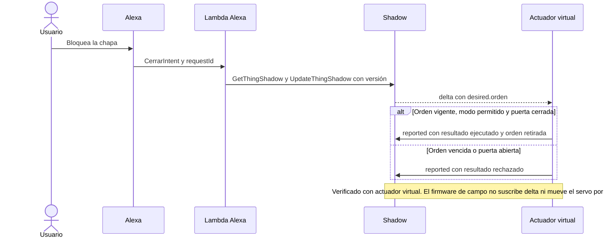

**3. Vinculación usuario–Thing**

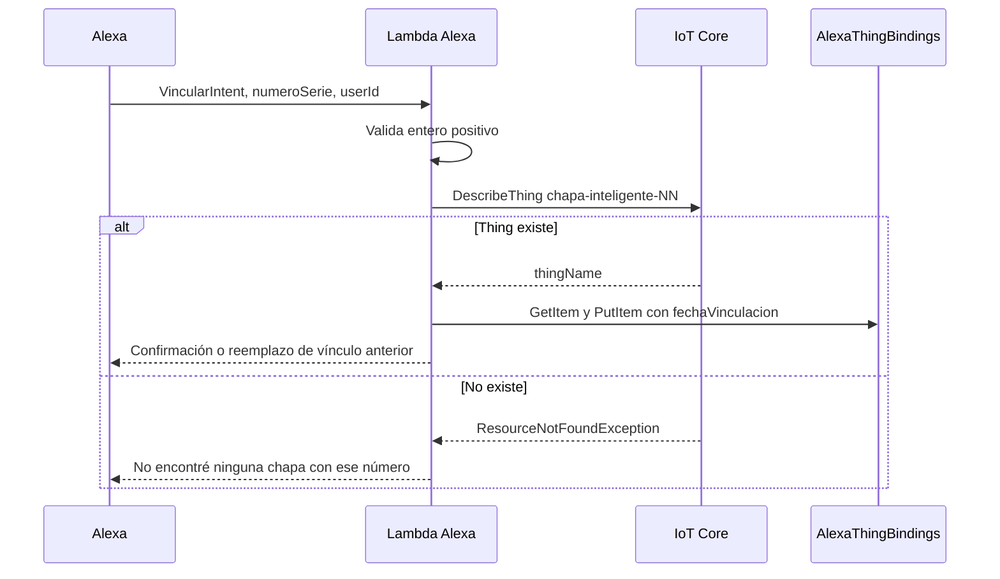

**4. Captura y comunicación de un evento de sensor**

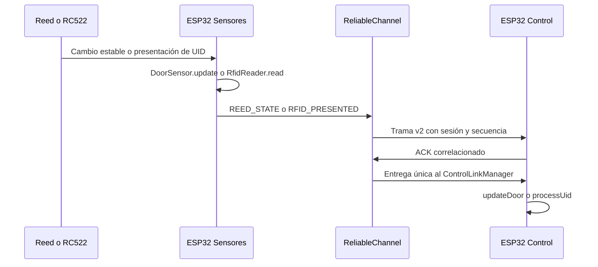

**5. Procesamiento local de un evento RFID**

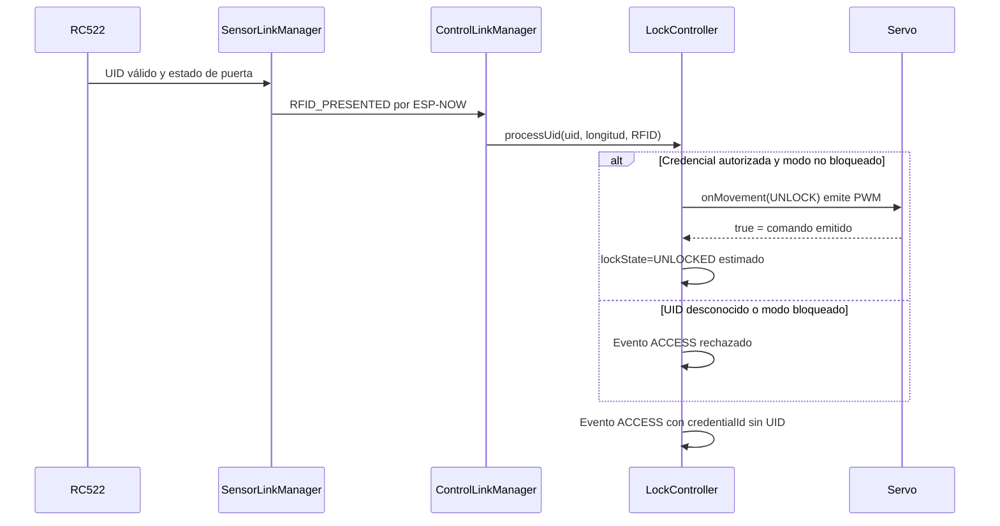

**6. Comportamiento observado de la lógica automática**

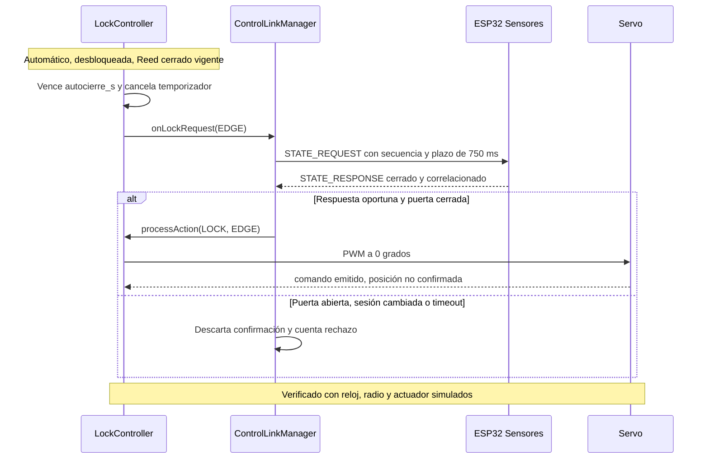

**7. Almacenamiento de datos: ESP32 → IoT Rule → Lambda → DynamoDB**

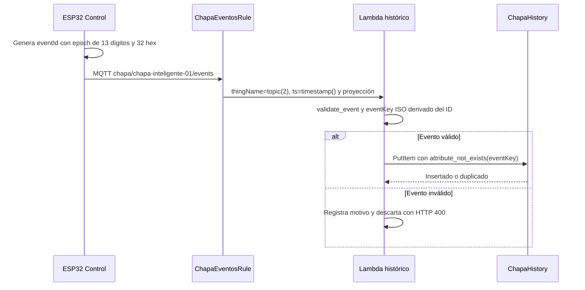

**8. Publicación del estado reportado**

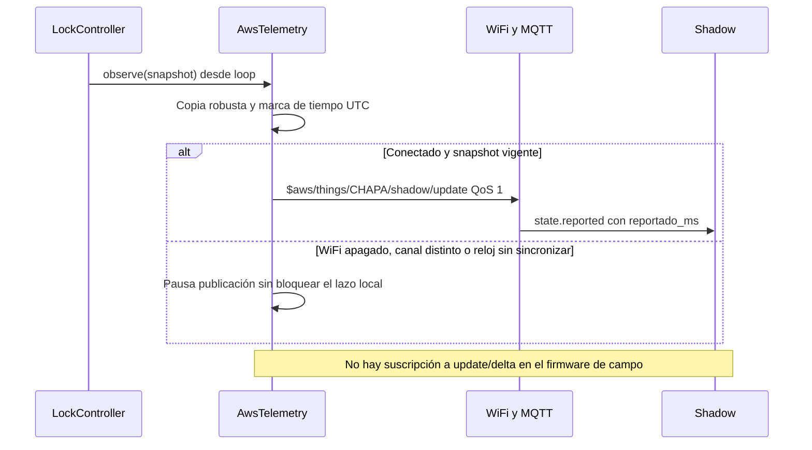

**9. Detección de pérdida de comunicación y recuperación**

```mermaid
sequenceDiagram
    participant S as ESP32 Sensores
    participant R as ReliableChannel
    participant CL as ControlLinkManager
    participant LC as LockController
    participant AT as AwsTelemetry
    S--xR: Pérdida de latidos ESP-NOW
    R->>R: link offline tras 3000 ms
    CL->>LC: checkSensorFreshness marca desconocida y cancela autocierre
    LC->>AT: Evento SENSOR sensor_offline
    S->>R: Nueva sesión y secuencia tras reinicio
    R->>CL: sessionChanged invalida lectura anterior
    CL->>LC: updateDoor con lectura nueva y vigente
    Note over AT: WiFi/MQTT se reconecta por separado; desired real permanece sin aplicar
```

**10. Consulta y solicitud de cambio de parámetros desde Alexa**

```mermaid
sequenceDiagram
    actor U as Usuario
    participant A as Alexa
    participant L as Lambda Alexa
    participant S as Shadow
    participant V as Dispositivo virtual
    U->>A: En qué modo está la chapa / cuál es el autocierre
    A->>L: ConsultarModoIntent / ConsultarAutocierreIntent
    L->>S: GetThingShadow
    S-->>L: reported vigente
    L-->>A: Modo o segundos reportados
    U->>A: Pon la chapa en modo manual / cambia el autocierre a 21 segundos
    L->>S: UpdateThingShadow con desired y versión
    S-->>V: delta
    V->>S: reported con valores aplicados
    Note over S,V: Cambios verificados en loopback y con sustitutos; placa no aplica desired
```

### 2.6 Lógica de control

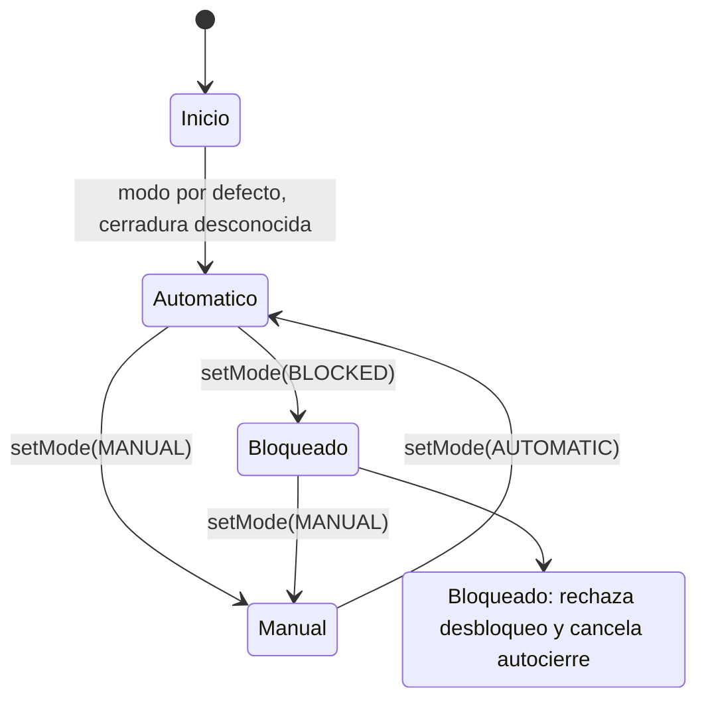

```mermaid
stateDiagram-v2
    [*] --> Espera
    Espera --> Cuenta: Automatico, desbloqueada, Reed cerrado y vigente
    Cuenta --> Espera: Puerta abierta, sensor vencido o cambio de modo
    Cuenta --> Cuenta: Cambio de autocierre reinicia intervalo
    Cuenta --> Confirmar: Vence el temporizador
    Confirmar --> Ejecutar: STATE_RESPONSE cerrado, correlacionado y oportuno
    Confirmar --> Espera: Respuesta abierta, sesión nueva o vencimiento de 750 ms
    Ejecutar --> Espera: PWM emitido o fallo registrado
```

El modo `BLOCKED` rechaza desbloqueos y cancela el temporizador. La apertura requiere credencial autorizada y modo distinto de bloqueado. El bloqueo exige Reed vigente y `closed`; si el sensor vence, el estado se vuelve `desconocida` y se cancela el autocierre. Los UID desconocidos generan un evento `ACCESS` rechazado sin mover el servo. Ante pérdida de ESP-NOW, `ControlLinkManager` declara el enlace offline después de 3 s, invalida la lectura y descarta confirmaciones pendientes; la recuperación exige una sesión nueva y una lectura válida.

La lógica automática reside en el Edge por cinco razones: latencia determinista frente a un viaje ida y vuelta a la nube; independencia de Internet; disponibilidad inmediata de Reed, UID y estado del servo; reducción de mensajes MQTT al no consultar la nube para cada decisión; y separación clara entre decisión local y registro remoto. La nube procesa la proyección de la regla, valida y persiste eventos, mantiene el Shadow y responde consultas; no gobierna el actuador físico en la configuración actual.

### 2.7 Device Shadow

**Contrato real.** Tópico clásico `$aws/things/chapa-inteligente-01/shadow`. El firmware publica en `update` y no ejecuta `get`, `update/delta`, `update/accepted` ni `update/rejected`. La Lambda de Alexa usa `GetThingShadow` y `UpdateThingShadow` con control de versión.

| Sección | Atributo | Tipo | Valores válidos y significado |
|---|---|---|---|
| `desired` persistente | `modo` | string | `manual`, `automatico`, `bloqueado`; solicitado por voz, no aplicado en campo |
| `desired` persistente | `autocierre_s` | entero | 5–120 s; solicitado por voz, no aplicado en campo |
| `desired` puntual | `orden` | objeto | `id` string, `accion` `bloquear`/`desbloquear`, `vence_ms` epoch UTC; plazo de 30 s |
| `reported` | `puerta` | string | `abierta`, `cerrada`, `desconocida`; estado del Reed con vigencia local de 3 s |
| `reported` | `cerradura` | string | `bloqueada`, `desbloqueada`, `desconocida`; estimación derivada del PWM, sin confirmación mecánica |
| `reported` | `modo`, `autocierre_s` | string, entero | Configuración vigente en el controlador |
| `reported` | `reportado_ms` | entero | Marca UTC epoch en milisegundos usada para decidir vigencia de 60 s con tolerancia de 5 s |
| `delta` | cualquier diferencia | objeto | Diferencia pendiente; en el Thing real existe por el `desired` no aplicado |
| metadata/versión | `version`, `timestamp` | entero | Control optimista de actualizaciones |

Ejemplo sanitizado del documento observado el 24/11/2026 (hora del snapshot derivada de `reportado_ms`):

```json
{
  "state": {
    "desired": {
      "modo": "bloqueado",
      "cerradura": "desbloqueada"
    },
    "reported": {
      "puerta": "desconocida",
      "cerradura": "desconocida",
      "modo": "automatico",
      "autocierre_s": 10,
      "reportado_ms": 1795557376854
    },
    "delta": {
      "modo": "bloqueado",
      "cerradura": "desbloqueada"
    }
  },
  "version": 28
}
```

`1795557376854` corresponde a `2026-11-24T21:56:17.654Z`. El `desired.modo=bloqueado` y `desired.cerradura=desbloqueada` son órdenes configuradas o residuales que el firmware no consume; el `reported` describe lo que el controlador estima. La posición ordenada del servo (`0°` o `90°`) no es confirmación del cerrojo: no existe sensor de pestillo.

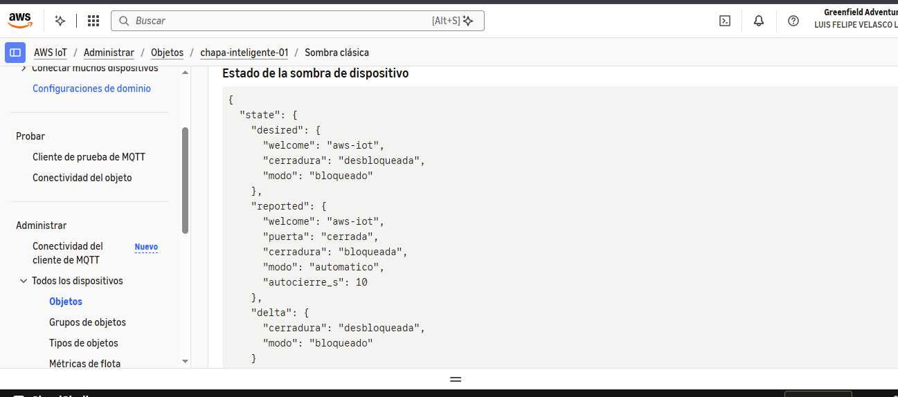

*Figura 4. Estado de ejemplo del Device Shadow (E09). La captura original no prueba vigencia ni origen físico.*

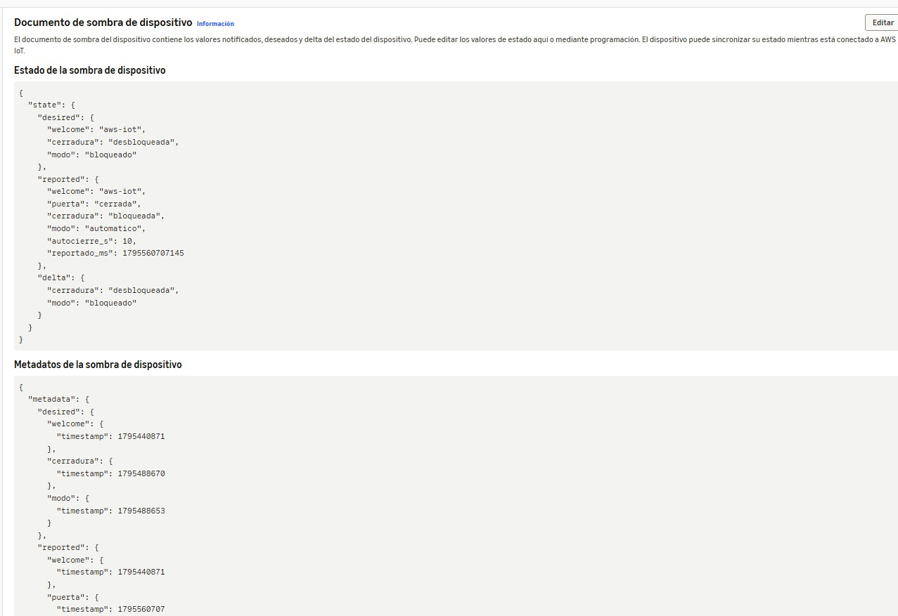

*Figura 5. Documento actualizado observado durante la verificación (E10).*

### 2.8 Modelo de datos de DynamoDB

**Tablas verificadas**

| Tabla | Clave de partición | Clave de ordenamiento | Atributos principales | Índices | TTL |
|---|---|---|---|---|---|
| `ChapaHistory` | `thingName` (S) | `eventKey` (S) | `eventId`, `ts`, `ingresoTs`, `ttl` (N), `tipo`, `origen`, `resultado`, `puerta`, `cerradura`, `modo`, `motivo`, `credentialId`, `seq` (N), `autocierre_s` (N), `diferido` (B) | Sin GSI ni LSI | Habilitado en `ttl`; retención de 30 días desde el ingreso |
| `AlexaThingBindings` | `userId` (S) | No aplica | `thingName` (S), `fechaVinculacion` (S) | Sin GSI ni LSI | Deshabilitado |

Ambas usan capacidad bajo demanda. La clave `eventKey` se construye como `<ISO UTC con milisegundos derivado de los 13 dígitos de eventId>#<32 hex>`; el sufijo es el mismo que el de `eventId`. La estrategia de identificación combina época de captura y 128 bits aleatorios, por lo que dos eventos en el mismo milisegundo permanecen distinguibles. La prevención de duplicados se apoya en `PutItem` con `ConditionExpression="attribute_not_exists(eventKey)"`; el reenvío con el mismo `eventId` devuelve `duplicado=true` sin alterar `ingresoTs` ni `ttl`. Los datos se separan por `thingName`, y el vínculo de voz se resuelve por `userId`. No se declaran índices secundarios ni consultas por atributo que el esquema no pueda satisfacer.

Ejemplo anonimizado compatible con las filas observadas:

```json
{
  "thingName": "chapa-inteligente-01",
  "eventKey": "2026-11-24T22:01:46.123Z#<32-hex>",
  "eventId": "1795557706123#<32-hex>",
  "ts": "2026-11-24T22:01:46.123Z",
  "ingresoTs": "2026-11-24T22:01:47.536Z",
  "ttl": 1795557707,
  "tipo": "lectura",
  "origen": "edge",
  "resultado": "ejecutado",
  "puerta": "desconocida"
}
```

| Patrón de acceso | Información necesaria | Clave o consulta | Filtrado / procesamiento adicional |
|---|---|---|---|
| Historial reciente de un Thing | Eventos ordenados por fecha | `Query(PK=thingName, ScanIndexForward=false, Limit=n)` | Ninguno para orden; filtrar en cliente si se desea un tipo |
| Rango horario | Lecturas y movimientos entre dos fechas | `Query` con `eventKey BETWEEN inicioISO AND finISO` | Convertir fechas locales a UTC; excluir límites según criterio de intervalo |
| Conteo por origen | Distribución RFID/Edge/voz | `Query` paginado por partición y rango | Agrupar por `origen` en el cliente; no hay índice por origen |
| Detección de duplicados | Una fila por `eventId` | `GetItem` por `thingName` y `eventKey` derivado | Verificar `eventId` si se recibe con otro prefijo |
| Latencia de persistencia | Diferencia de marcas | `Query` y lectura de `ts`/`ingresoTs` | Calcular `ingresoTs − ts`; no equivale a latencia física |
| Vínculo de un usuario | Thing asociado | `GetItem(PK=userId, ConsistentRead=true)` | Ninguno |
| Alertas por Thing o sesión | Eventos rechazados o sensor offline | `Query` por Thing y rango | Filtrar `resultado`, `tipo` o `motivo` en cliente |

La eliminación por TTL es eventual: una fila expirada puede seguir visible temporalmente. Los reportes deben limitarse al horizonte retenido y tratar los atributos ausentes como «Sin dato».

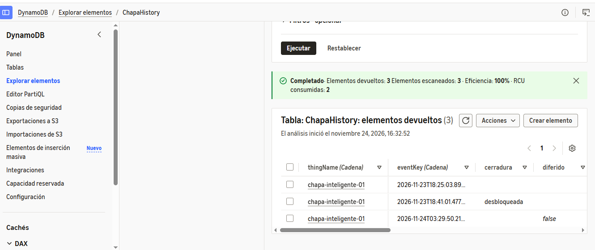

*E16. Tabla ChapaHistory.*

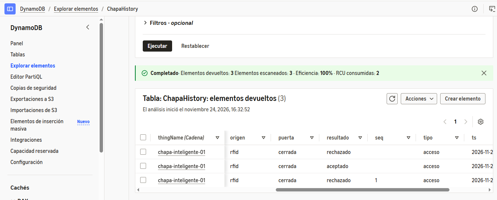

*E17. Registros almacenados.*


### 2.9 IoT Rules y funciones Lambda

**Regla desplegada `ChapaEventosRule`.** Habilitada, versión SQL `2016-03-23`, origen `chapa/chapa-inteligente-01/events`, destino `chapa-almacenar-evento`:

```sql
SELECT topic(2) AS thingName, timestamp() AS ts, eventId, tipo, origen, resultado,
       puerta, cerradura, modo, motivo, credentialId, seq, diferido, autocierre_s, simulado
FROM 'chapa/chapa-inteligente-01/events'
```

La proyección impide que el cuerpo suplante `thingName` y `ts`, ambos derivados del tema y del servicio. El campo `simulado` permite a la Lambda descartar mensajes de prueba marcados como tales. El permiso de invocación observado usa `principal=iot.amazonaws.com`, `lambda:InvokeFunction` y `sourceArn=...:rule/ChapaEventosRule`. No se identificó un rol de ejecución de regla separado para esta acción.

**Lambda `chapa-almacenar-evento`.** Valida objeto, Thing, enumeraciones, longitudes de texto, rangos numéricos, coherencia de `bloqueo`/`desbloqueo` con `cerradura` y `resultado`, formato de `eventId` y relación temporal entre ocurrencia e ingreso. Deriva `eventKey`, escribe con condición de no existencia, marca duplicados y propaga errores transitorios para reintento. Los errores de validación se registran y devuelven HTTP 400 sin escribir.

**Lambda `chapa-skill-alexa`.** Resuelve el vínculo por `userId`, comprueba existencia del Thing, administra alta, reemplazo y baja, consulta Shadow, exige snapshot vigente y escribe `desired` con la versión leída para detectar conflictos. Está separada de la Lambda de almacenamiento: nunca escribe en `ChapaHistory` y esta nunca procesa solicitudes de voz.

| Configuración desplegada verificada | Valor sanitizado |
|---|---|
| Región | `us-east-2` |
| Thing / client ID | `chapa-inteligente-01` |
| Certificado | `ACTIVE`; contenido privado no versionado ni reproducido |
| Política IoT v2 | `iot:Connect` solo `client/chapa-inteligente-01`; `iot:Publish` en `topic/chapa/chapa-inteligente-01/events` y `topic/$aws/things/chapa-inteligente-01/shadow/update` |
| Lambdas | `python3.13`, handler `lambda_function.lambda_handler`, 128 MB; timeout 3 s (histórico) y 10 s (Alexa); rol `PowerUserRole` |
| Permisos de invocación | IoT→historial por ARN de regla; Alexa→skill con `eventSourceToken` sanitizado |
| Observabilidad | CloudWatch Logs para ambas funciones; invocaciones recientes de histórico, sin invocaciones recientes de Alexa |

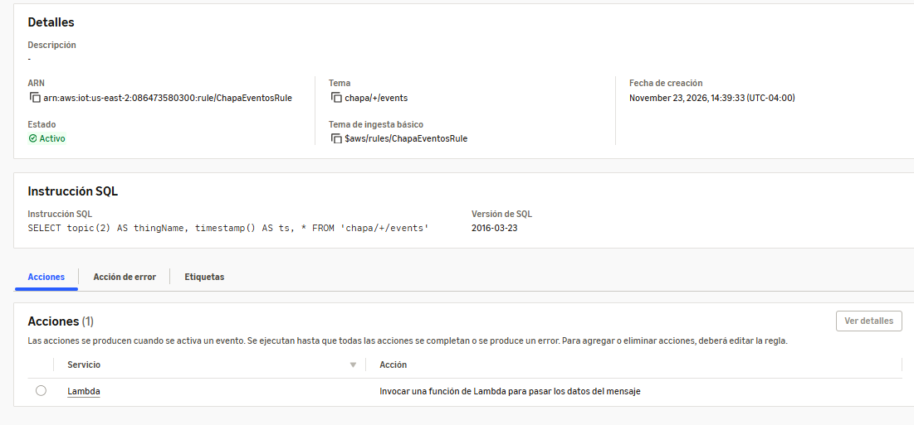

*Figura 6. Vista de la regla IoT (E12).*

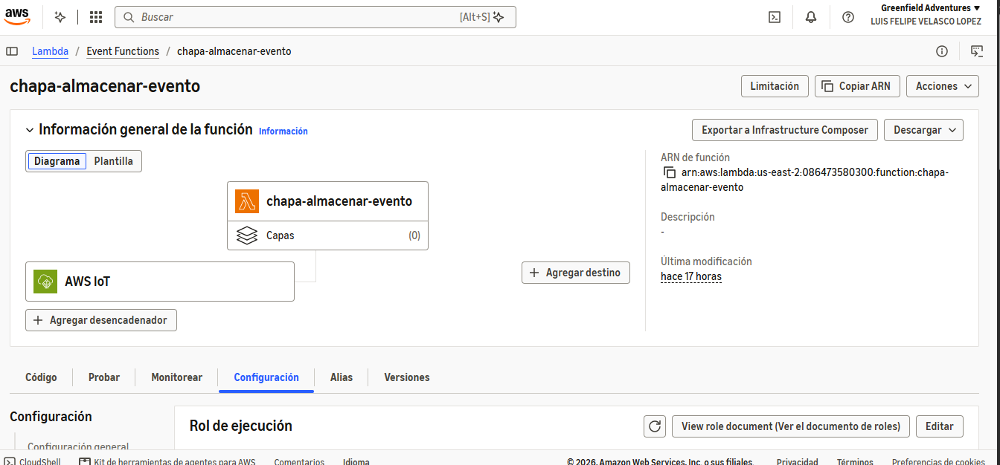

*Figura 7. Configuración de `chapa-almacenar-evento` (E13).*

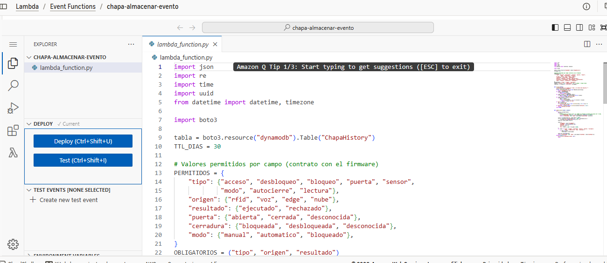

*Figura 8. Código observado en consola (E14). El código local no prueba por sí solo el hash desplegado.*

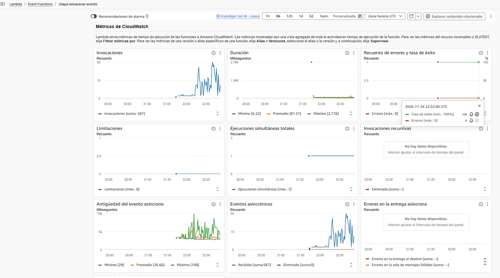

*Figura 9. Registro de ejecución de la Lambda de histórico (E15).*

### 2.10 Skill de Alexa

| Elemento | Configuración real |
|---|---|
| Nombre de invocación | `chapa inteligente` |
| Idioma | `es-MX` |
| Intents personalizados | `VincularIntent`, `DesvincularIntent`, `EstadoPuertaIntent`, `EstadoCerraduraIntent`, `AbrirIntent`, `CerrarIntent`, `ConsultarModoIntent`, `CambiarModoIntent`, `ConsultarAutocierreIntent`, `CambiarAutocierreIntent` |
| Intents de Amazon | `Cancel`, `Help`, `Stop`, `Fallback`, `NavigateHome` |
| Slots | `numeroSerie` y `segundos` (`AMAZON.NUMBER`); `modo` (`ModoOperacion`) |
| Tipo personalizado | `ModoOperacion` con IDs `manual`, `automatico`, `bloqueado` y sinónimos declarados |
| Frases configuradas | «vincula mi chapa con el número {numeroSerie}», «cómo está la puerta», «estado de la chapa», «bloquea la chapa», «pon la chapa en modo {modo}», «cambia el autocierre a {segundos} segundos» |
| Vinculación | `userId` de Alexa → `thingName` en `AlexaThingBindings`; se valida que el Thing exista |
| Consultas | Puerta, cerradura, modo y tiempo de autocierre; respuesta alternativa si el snapshot no es vigente |
| Errores | Slot numérico inválido, Thing inexistente, sin vínculo, falta de snapshot, modo no permitido, orden caducada, conflicto de versión y error genérico |

Diferenciación probatoria: las frases están **configuradas** en el modelo; la lógica de intents está **probada** con solicitudes simuladas; la persistencia entre sesiones y la actuación física están **sin verificar**. `intents.png` acredita el modelo compilado, no una invocación. `AlexaConsultas.jpeg` se entrega como registro de consultas, pero no incluye una medición correlacionada con el servo ni con el monitor serie.

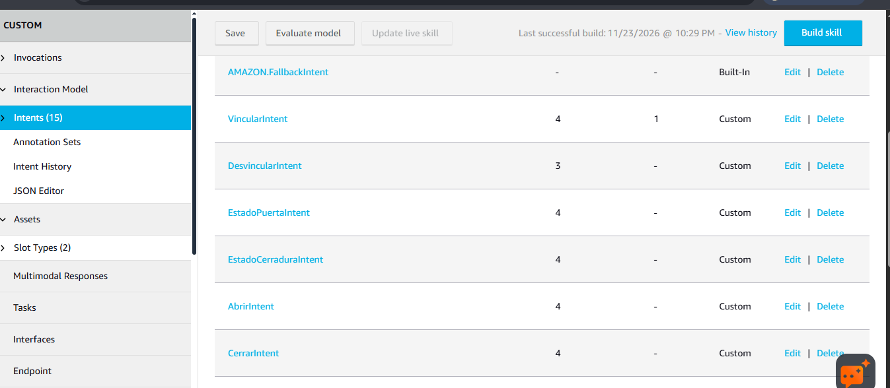

*Figura 10. Intents del modelo en español (E19). No acredita ejecución de frases.*

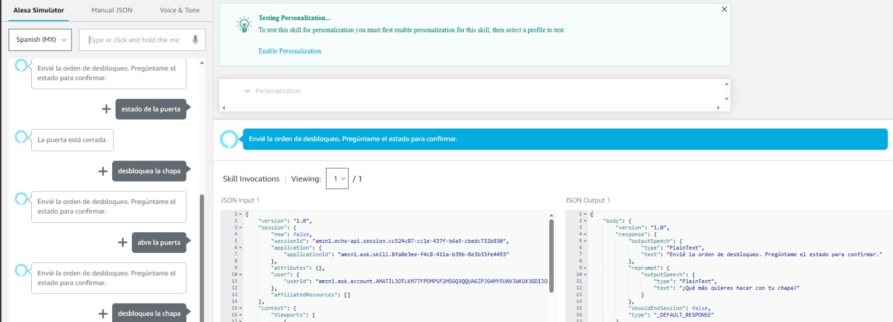

*Figura 11. Registro de consultas entregado (E22). Su valor probatorio se limita a la respuesta de voz observada, sin confirmación física.*

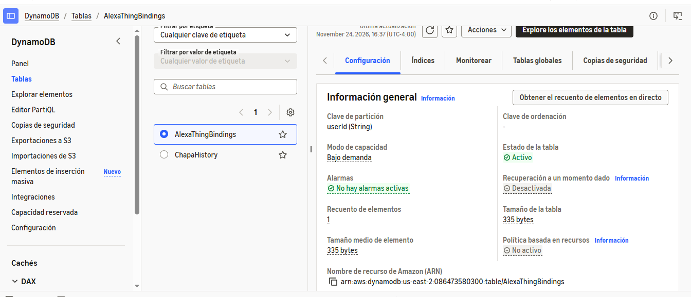

*E20. Vinculación usuario–Thing.*

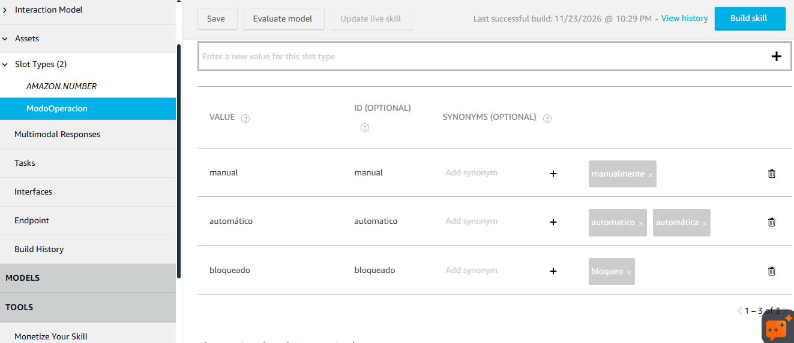

*E21. Modo de operación.*


### 2.11 Mockups de reportes

Los [mockups de reportes](mockups-reportes.md) son diseños de interfaz, no aplicaciones implementadas. Los valores de las pantallas son ilustrativos salvo la muestra anonimizada de `ChapaHistory` incorporada en el documento.

| Mockup | Decisión del usuario | Atributos DynamoDB | Patrón de acceso | Cálculo | Limitación |
|---|---|---|---|---|---|
| Panel de estado e historial | Determinar si la puerta quedó cerrada y qué origen generó el último cambio | `puerta`, `cerradura`, `tipo`, `origen`, `resultado`, `ts` | `Query` por Thing y rango, descendente | Última fila válida por `eventKey` | `desconocida` se muestra sin inferir posición mecánica |
| Historial de aperturas y cierres | Verificar secuencia de accesos y cierres en un turno | `tipo`, `ts`, `origen`, `resultado` | `Query` por rango ISO UTC | Filtrar `bloqueo`/`desbloqueo`/`puerta` en cliente | Sin índice por tipo; requiere recorrer páginas |
| Actividad RFID | Detectar presentaciones rechazadas y credenciales usadas | `credentialId`, `origen`, `resultado`, `ts` | `Query` por Thing y rango | Agrupar por `credentialId` seudonimizado | UID no disponible; `credentialId` es identificador de prototipo |
| Eventos de autocierre | Comprobar cuándo el Edge cerró la puerta y con qué retardo configurado | `autocierre_s`, `origen`, `resultado`, `diferido`, `ts` | `Query` por Thing y rango | Filtrar `origen=edge` y `tipo=autocierre` | No mide latencia física; `diferido` solo marca espera previa a SNTP |
| Distribución por origen | Comparar dependencia de RFID, voz y Edge | `origen`, `tipo`, `resultado` | `Query` paginado por Thing y rango | Conteo agrupado en cliente | Sin GSI por origen; TTL puede eliminar datos antiguos |
| Disponibilidad y pérdida de comunicación | Identificar lapsos con `sensor_offline` o ausencia de lecturas | `tipo=sensor`, `motivo`, `ts`, `puerta` | `Query` por Thing y rango | Detectar brechas entre marcas y eventos `sensor_offline` | La ausencia de mensajes no se distingue de una cola descartada sin conteo de publicaciones |

---

## 3. Desarrollo e implementación

### 3.1 Estructura real del repositorio

```text
practica4PuertaInteligente/
├── aws/
│   ├── alexa/interaction-model/es-MX.json
│   ├── config/                 # exportación sanitizada y plantillas propuestas
│   ├── lambda/
│   │   ├── chapa-almacenar-evento/lambda_function.py
│   │   └── chapa-skill-alexa/lambda_function.py
│   └── virtual_device/         # cliente MQTT virtual de laboratorio
├── docs/
│   ├── Informe-Final-Practica-4-Grupo-7.md           # este informe
│   ├── mockups-reportes.md
│   ├── revision-aws.md
│   └── cierre-practica-4.md
├── evidencias/                 # 22 archivos E01–E22
├── firmware/
│   ├── esp32_control/          # control, servo, lista de credenciales, telemetría
│   └── esp32_sensors/          # Reed, RC522 y enlace local
├── shared/Protocol/            # trama v2, ESP-NOW y canal confiable
└── tests/                      # suites C++ y Python con hardware simulado
```

### 3.2 Módulos principales

El nodo de sensores combina `DoorSensor`, `RfidReader` y `SensorLinkManager`. El de control integra `LockController`, `CredentialList`, `LockServo`, `ControlLinkManager` y `AwsTelemetry`. El módulo compartido `Protocol` define la trama y las reglas de validación; `EspNowLink` gestiona el transporte; `ReliableChannel` añade confiabilidad. Las dos Lambda son módulos Python sin clases: la de histórico valida y persiste; la de Alexa gestiona vínculos, Shadow e intents.

### 3.3 Fragmentos representativos

**Captura y validación de sensores.** `firmware/esp32_sensors/src/DoorSensor.cpp:27-36` exige estabilidad antes de publicar un cambio:

```cpp
if (reading != candidate_) {
  candidate_ = reading;
  stableSince_ = now;
}
if (candidate_ != stable_ &&
    static_cast<uint32_t>(now - stableSince_) >= Config::DEBOUNCE_MS) {
  stable_ = candidate_;
  return true;
}
```

Resuelve el rebote mecánico del Reed. Produce una transición estable y evita que un pulso momentáneo invalide el temporizador de autocierre.

**Formato y validación de mensajes.** `shared/Protocol/src/Protocol.cpp:14-31` valida versión, tipo, sesión, secuencia, enumeraciones, relleno del UID y coherencia por tipo. `encode()` rechaza cualquier mensaje inválido antes de ocupar la trama de 34 bytes. El resultado es que una trama mal formada nunca actualiza la vigencia del sensor.

**Serialización de telemetría.** `firmware/esp32_control/src/AwsTelemetryPayload.cpp:70-98` convierte enums internos al vocabulario externo y construye tres payloads:

```cpp
bool reading(char* output, size_t capacity, const Snapshot& snapshot, const char* eventId) {
  return fits(snprintf(output, capacity, "{\"eventId\":\"%s\",\"tipo\":\"lectura\","
    "\"origen\":\"edge\",\"resultado\":\"ejecutado\",\"puerta\":\"%s\"}",
    eventId, doorName(snapshot.door)), capacity);
}
```

El problema resuelto es el acoplamiento entre tipos C++ y el contrato de la IoT Rule. La función devuelve `false` si el buffer no alcanza, evitando JSON truncado. `reported()` usa `reportado_ms` para que la Lambda de Alexa pueda evaluar vigencia.

**Procesamiento y almacenamiento de eventos.** `aws/lambda/chapa-almacenar-evento/lambda_function.py:95-123` separa validación de persistencia:

```python
error = validate_event(event)
if error:
    LOGGER.warning("Discarded event: %s", error)
    return {"statusCode": 400, "body": json.dumps({"descartado": error})}
...
history_table().put_item(
    Item=item, ConditionExpression="attribute_not_exists(eventKey)")
```

Un mensaje inválido no contamina el histórico; un reenvío se reporta como duplicado; una falla transitoria se propaga para reintento de la regla.

**Identificación y deduplicación.** `firmware/esp32_control/src/AwsTelemetry.cpp:33-38` genera `<epoch de 13 dígitos>#<32 hex>` con 128 bits aleatorios, y `:210-219` conserva el ID al reintentar el mismo evento de la cola. `ReliableChannel.cpp:17-23` aplica el mismo principio en el enlace local mediante sesión, secuencia y ACK.

**Consultas de estado.** `aws/lambda/chapa-skill-alexa/lambda_function.py:123-155` usa `reportado_ms` con ventana de 60 s y tolerancia de 5 s. Si falta o es antiguo, responde que no tiene lectura reciente en lugar de inventar un estado.

**Resolución de vinculaciones.** `lambda_function.py:73-75` y `:102-120` hacen `GetItem` consistente por `userId`, validan la existencia del Thing con `DescribeThing` y escriben `fechaVinculacion`. El vínculo se aísla por usuario y se reemplaza sin borrar el de otros.

**Pruebas automatizadas.** `tests/test_aws_integration.py:318-334` publica cinco muestras dos veces cada una contra un sustituto de DynamoDB y comprueba cinco filas únicas con su origen. `test_virtual_mqtt.py:169-210` levanta un broker MQTT sobre TLS mutuo en loopback con certificados efímeros y verifica CONNECT, SUBSCRIBE, `/get`, `delta`, `reported` y PUBACK. Ninguna de estas pruebas modifica AWS ni acciona hardware.

### 3.4 Configuración AWS y seguridad

| Elemento | Estado verificado | Observación de seguridad |
|---|---|---|
| Región y Thing | `us-east-2`, `chapa-inteligente-01`, certificado `ACTIVE` | ARN de cuenta sanitizados; sin contenido PEM en el repositorio |
| Política IoT | Versión 2, `Connect` y dos `Publish` | Principio de mínimo privilegio aplicado al publicador; no permite `Subscribe`, `Receive` ni `desired` |
| IoT Rule | Habilitada, tema fijo y proyección explícita | Evita suplantación de `thingName` y `ts` |
| Lambdas | Python 3.13, 128 MB, rol `PowerUserRole` | El rol es más amplio que lo necesario; las [políticas propuestas](../aws/config/lambda-roles.proposed.json) no están aplicadas |
| DynamoDB | Bajo demanda; TTL activo solo en `ChapaHistory` | Sin índices secundarios; acceso por clave |
| CloudWatch | Logs de ambas Lambdas | No se registran invocaciones recientes de Alexa |
| Configuraciones exportadas | [`deployed-sanitized.json`](../aws/config/deployed-sanitized.json) describe lo observado; `*.proposed.json` son plantillas | Las plantillas usan marcadores `<ACCOUNT_ID>` y `<SKILL_ID>` |
| Repositorio | `.gitignore` excluye cabeceras privadas, configuraciones locales y certificados | UID de prototipo y una MAC observada permanecen en fuentes históricas; tratarlos como sensibles |

Los permisos comprobados son los de la política v2, la regla y los roles tal como aparecen en la exportación sanitizada. Los permisos recomendados son los de `lambda-roles.proposed.json`: `dynamodb:PutItem` y logs para histórico; `GetItem`/`PutItem`/`DeleteItem` sobre `AlexaThingBindings`, `iot:DescribeEndpoint`, `DescribeThing`, `GetThingShadow`, `UpdateThingShadow` y logs para Alexa. No se aplicaron cambios durante la elaboración de este informe.

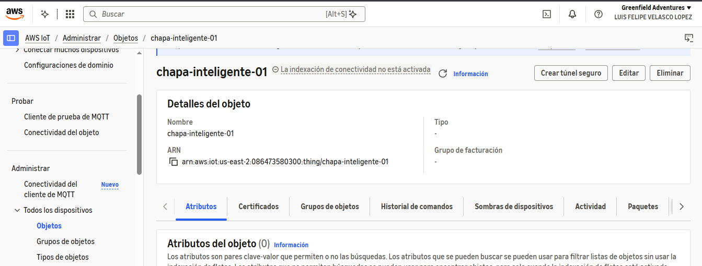

*E07. Thing en AWS IoT Core.*

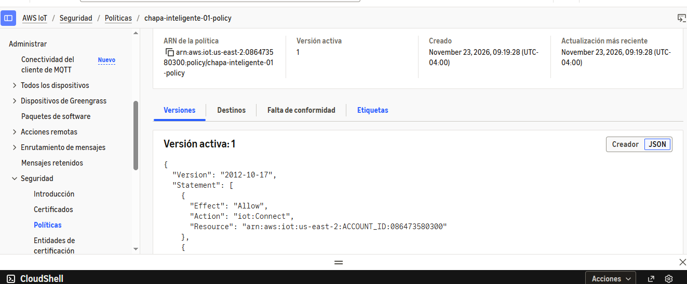

*E08. Política IoT.*


### 3.5 Configuración de Alexa y su relación con la Lambda

El modelo `es-MX.json` se despliega en Alexa Developer Console y apunta a `chapa-skill-alexa`. La Lambda recibe `event.context.System.user.userId`, resuelve el Thing y usa el endpoint de datos ATS para Shadow. El despliegue auditado conserva el hash anterior de la Lambda; las correcciones locales de vigencia y deduplicación se validaron con sustitutos. Las respuestas verificadas en simulación incluyen «La puerta está cerrada», «El último estado reportado indica que la chapa está desbloqueada», «Todavía no tengo una lectura reciente de la puerta» y «Envié la orden de bloquear. Pregúntame el estado para confirmar».

---

## 4. Pruebas y validaciones

### 4.1 Organización y método

Los identificadores siguen la convención solicitada: PF físicas, PC comunicación local, PA AWS, PV Alexa, PL lógica automática, PU unitarias y PNF no funcionales. Las pruebas de software se ejecutaron desde la raíz del repositorio con hardware simulado; no se realizaron nuevas consultas ni escrituras en AWS durante la redacción.

```powershell
python -B -m unittest discover -s tests -p 'test_*.py' -v
& "$env:USERPROFILE/.platformio/penv/Scripts/python.exe" tests/run_tests.py
```

### 4.2 Catálogo de pruebas

| ID | Objetivo y RF | Condiciones iniciales | Método y criterio | Resultado observado | Estado | Evidencia e interpretación |
|---|---|---|---|---|---|---|
| PF-01 | Verificar Reed y RFID en montaje (RF1) | Placas alimentadas, servo aislado | Abrir/cerrar en serie declarada y presentar tarjeta, llavero y UID desconocido | Sin serie declarada ni conteo de aciertos; captura de prueba entregada por el equipo | No verificado | E03, E05. La foto no sustituye una medición |
| PF-02 | Verificar PWM y recorrido del servo (RF1, RF13) | Servo sin acople y fuente de 5 V supervisada | Comando local y observación mecánica | Compilación y lógica disponibles; recorrido/retención no documentados | No verificado | E02. No se deduce movimiento del comando PWM |
| PF-03 | Medir autocierre físico (RF13) | Reed vigente, modo automático, desbloqueada | Cronometrar desde vencimiento hasta bloqueo observado | Solo reloj simulado | No verificado | E06. La imagen no incluye medición temporal correlacionada |
| PC-01 | Validar trama v2 y rechazo de mensajes (RF1) | Sustitutos de radio | Enviar longitudes, versiones, tipos y UID inválidos | 91/91 C++ históricos, incluidos casos de protocolo | Cumple en simulación | [`protocol_tests.cpp`](../tests/protocol_tests.cpp); no implica radio real |
| PC-02 | Verificar ACK, sesiones y deduplicación (RF13) | `ReliableChannel` con enlace simulado | Reintentos, duplicados, cambio de sesión y timeout | Casos simulados aprobados | Cumple en simulación | [`link_tests.cpp`](../tests/link_tests.cpp) |
| PC-03 | Confirmación previa al bloqueo (RF3, RF13) | Reed cerrado y `STATE_RESPONSE` simulada | Correlacionar sesión/secuencia y plazo de 750 ms | Aprobado con radio simulada; rechazo de respuesta abierta y vencida | Cumple en simulación | [`ControlLinkManager.cpp:22-32`](../firmware/esp32_control/src/ControlLinkManager.cpp#L22-L32) |
| PC-04 | Continuidad ESP-NOW y recuperación (RF13) | Enlace activo y reinicio del nodo sensor | Observar latidos, sesión nueva y vigencia | Intermitencias reportadas por el equipo; causa no confirmada | No verificado | Requiere registro de `link status` conmarcas temporales |
| PA-01 | Estado de la regla y permiso (RF10) | Proyecto AWS en `us-east-2`, solo lectura | `get-topic-rule` y revisión de permiso | Regla activa con SQL explícita y permiso por ARN de regla | Cumple y verificado | E12, E13, [exportación](../aws/config/deployed-sanitized.json) |
| PA-02 | Publicación y Shadow (RF2, RF14) | Consulta CLI del 24/11/2026 | Leer Shadow clásico | v28, `reportado_ms=1795557376854`, `puerta=desconocida`, `modo=automatico`, `autocierre_s=10` | Verificación parcial | E09, E10; no acredita Reed vigente ni emisor |
| PA-03 | Invocación de histórico (RF10) | CloudWatch Logs | Revisar START/REPORT de `chapa-almacenar-evento` | Invocaciones entre 21:44:20Z y 21:54:47Z; duraciones 25–2778 ms | Cumple y verificado | E15; la duración es de Lambda, no latencia física |
| PA-04 | Tablas y vínculos (RF7) | DescribeTable / DescribeTTL | Comparar esquemas con la exportación | Claves y TTL confirmados; pares usuario-Thing no consultados en vivo | Verificación parcial | E07, E20 |
| PA-05 | Registros y latencia (RF11, RF12) | Query consistente por Thing | Leer 31 filas y calcular `ingresoTs − ts` | 31 lecturas `edge`; 0,695–2,413 s; tres filas `rfid` antiguas | Verificación parcial | E16, E17; sin denominador de publicaciones |
| PA-06 | Política IoT (seguridad) | Solo lectura | Comparar versión activa con exportación | v2 limitada a `Connect` y dos `Publish` | Cumple y verificado | E08; sin `Subscribe` en campo |
| PV-01 | Consulta de puerta por voz (RF4) | Solicitud Alexa simulada con snapshot vigente | Verificar respuesta en español | «La puerta está cerrada.»; sin invocación real reciente | Cumple en simulación | E19, E22 |
| PV-02 | Orden por voz y confirmación (RF5, RF3) | Actuador virtual conectado al Shadow simulado | `desired` con ID, vencimiento y versión | Movimiento virtual ejecutado una sola vez; rechazo de orden vencida | Cumple en simulación | [`test_aws_integration.py:281-308`](../tests/test_aws_integration.py#L281-L308) |
| PV-03 | Consulta y cambio de parámetros (RF14) | Modo y segundos simulados | Slot resolutions y rangos 5–120 | Modos y 21 s aplicados en virtual; valores inválidos rechazados | Cumple en simulación | [`test_aws_integration.py:222-229`](../tests/test_aws_integration.py#L222-L229) |
| PL-01 | Inicio y cancelación de autocierre (RF13) | Reloj simulado | Cambiar puerta, modo y vigencia | Inicia solo con cerrada/desbloqueada/automático; cancela al abrir o vencer | Cumple en simulación | [`control_tests.cpp`](../tests/control_tests.cpp) |
| PL-02 | Seguridad del bloqueo (RF3, RF13) | Respuesta de estado simulada | Intento de apertura o timeout | Bloqueo impedido; rechazo contabilizado | Cumple en simulación | E06, E21 |
| PU-01 | Suite de firmware C++ (RF1–RF3, RF13) | Hardware simulado, Zig C++ | 8 ejecutables con `-Wall -Wextra -Werror` | 91/91 en la versión de cierre; repetición posterior bloqueada por `PermissionError` en `zig.exe` | Histórico verificado | [`run_tests.py`](../tests/run_tests.py) |
| PU-02 | Suite Python de integración (RF4–RF12, RF14) | boto3, Shadow, DynamoDB y servo sustituidos | 20 casos de `test_aws_integration.py` | 20/20; 25/25 con la prueba MQTT en la suite completa | Cumple | [`test_aws_integration.py`](../tests/test_aws_integration.py) |
| PU-03 | MQTT/TLS en loopback (seguridad, RF2) | Certificados X.509 efímeros y broker simulado | CONNECT, SUBSCRIBE, `/get`, delta, `reported`, PUBACK | 5/5 pruebas de `test_virtual_mqtt.py`; sin conexión a AWS | Cumple en simulación | [`test_virtual_mqtt.py:169-210`](../tests/test_virtual_mqtt.py#L169-L210) |
| PU-04 | Deduplicación y descarte (RF11) | Sustituto de DynamoDB | Reenvío de IDs y mensajes inválidos | Cinco mensajes duplicados → cinco filas; inválidos descartados | Cumple en simulación | [`test_aws_integration.py:318-421`](../tests/test_aws_integration.py#L318-L421) |
| PU-05 | Contrato Alexa y slots (RF4–RF6, RF14) | Modelo y handlers locales | Resoluciones y límites numéricos | 15 intents coherentes; modos y 5–120 s validados | Cumple en simulación | E19, E21 |
| PNF-01 | Estabilidad (RNF) | Ventana de publicación AWS | Conteo de lecturas | ~17,5 min continuos sin reinicio observado | Verificación parcial | E17, E18 |
| PNF-02 | Latencia de almacenamiento (RNF) | 31 filas reales | `ingresoTs − ts` | 0,695–2,413 s, dentro del objetivo de 5 s para ese tramo | Cumple para el tramo | E17 |
| PNF-03 | Integridad y exactitud (RNF) | Sin conteo independiente | Comparar publicaciones y filas | No computable; 31 IDs únicos no constituyen denominador | No verificado | E17 |
| PNF-04 | Frecuencia de reporte (RNF) | Series de lecturas | Intervalo entre `ts` | ~30 s; cambio ≤1 s no medido | Verificación parcial | E11, E17 |
| PNF-05 | Operación offline y reconexión (RNF) | Sin corte físico ejecutado | Simulación y revisión de cola | Lógica local probada; `desired` real pendiente | No verificado en campo | E09, E10 |
| PNF-06 | Costo y secretos (RNF) | Estimación y revisión de archivos | Fórmula y escaneo de plantillas | USD 0,52/mes estimado; sin secretos en plantillas | Estimado / verificado parcialmente | [exportación](../aws/config/deployed-sanitized.json) |

### 4.3 Análisis de evidencias disponibles

- **RFID y autocierre.** E05 y E06 son registros entregados para las pruebas locales; no contienen una serie de datos ni marcas temporales que permitan calcular aciertos, omisiones o latencia. El comportamiento lógico está cubierto por pruebas unitarias con reloj y actuador simulados.
- **MQTT y Shadow.** E11 y E10 muestran tráfico reciente y un Shadow actualizado. La compatibilidad con `REPORT_MS = 30000` y con el formato de `eventId` es coherente con el firmware, pero no identifica al emisor ni demuestra un Reed vigente.
- **Lambda y DynamoDB.** E13–E17 acreditan configuración, código observado, ejecución y filas. El hash desplegado del histórico cambió respecto de la auditoría anterior; sin correlación con el código local no se afirma que la deduplicación corregida esté activa en el despliegue.
- **Alexa.** E19 y E21 acreditan modelo y slot; E22 se entrega como registro de consultas. No hay invocaciones recientes de la Lambda de Alexa en CloudWatch, por lo que no se reporta una sesión real verificada.
- **Compilaciones.** Se documentan 6/6 entornos PlatformIO y el enlace del entorno `aws_telemetry` con 929.401 bytes de flash sobre 1.310.720 disponibles. La compilación no demuestra comportamiento físico.

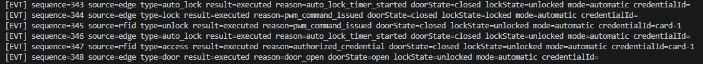

*E05. Prueba RFID.*

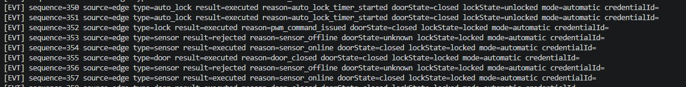

*E06. Prueba de autocierre.*

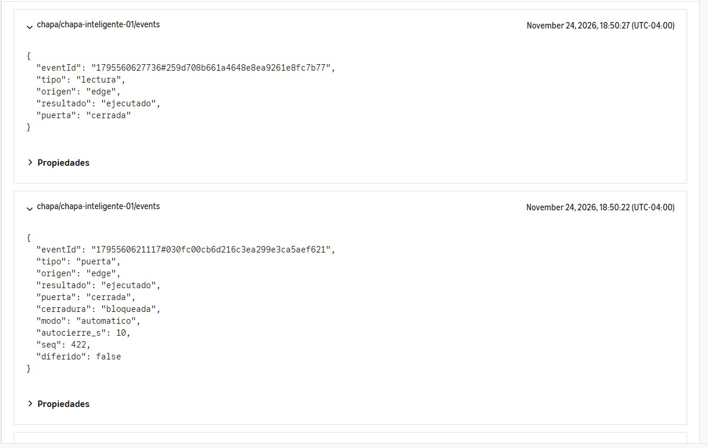

*E11. Eventos MQTT.*

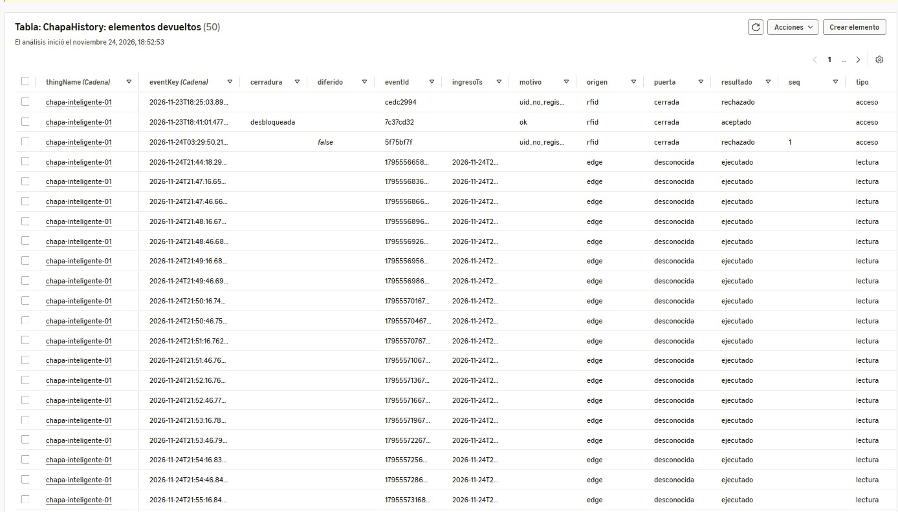

*E18. Registros del ESP32.*


### 4.4 Mediciones de DynamoDB

La ventana consultada contiene 31 filas `tipo=lectura`, `origen=edge`, `resultado=ejecutado` y `puerta=desconocida`, con intervalos cercanos a 30 s. Cada fila incluye `eventId`, `ingresoTs` y `ttl`. Las tres filas antiguas son `tipo=acceso`, `origen=rfid`, de los días 23 y 24. El valor `ingresoTs − ts` está entre 0,695 y 2,413 s; representa el tramo entre la marca temporal generada por la regla y el ingreso a DynamoDB. No incluye el recorrido sensor→ESP32→broker, ni el tiempo en cola cuando WiFi o SNTP no están disponibles. No se calcula integridad del 100 % porque no existe un conteo independiente de mensajes publicados.

### 4.5 Comunicación ESP-NOW intermitente

El equipo reportó desconexiones intermitentes del enlace local. **Causas confirmadas por código:** el canal de ESP-NOW se fija en la configuración y debe coincidir con el canal del AP (`EspNowLink.cpp:12-21`, `AwsTelemetry.cpp:101-130`); un cambio de sesión remota invalida lecturas previas y retira pendientes (`ReliableChannel.cpp:22-23`); la cola de reception tiene seis posiciones y las pendientes cuatro, con descarte contabilizado. **Hipótesis no confirmadas:** interferencia de WiFi en el mismo canal, alcance insuficiente, reinicios del nodo sensor y saturación durante la asociación TLS. Distinguirlas requiere correlacionar `link status`, `rx/tx`, `invalid`, `unauthorized`, `overflow`, `retries` y `exhausted` con marcas temporales.

### 4.6 Pruebas no verificadas

No se dispone de evidencia suficiente para declarar: exactitud Reed/RFID, respuesta por voz ≤3 s hasta movimiento, reanudación real con `desired` aplicado, integridad ≥99 %, latencia física extremo a extremo, actuación de servo por Alexa, persistencia real de vínculos entre sesiones, deduplicación con un `eventId` republicado en AWS y estabilidad bajo tráfico mixto. Estas pruebas quedan documentadas como pendientes, no como resultados esperados.

### 4.7 Estimación mensual de costos

La estimación usa la fórmula `costo = Σ (operaciones_mensuales_i × tarifa_i / 10^6)` sobre tarifas públicas de referencia, sin aplicar créditos, impuestos ni tráfico adicional de reconexión.

| Concepto | Frecuencia y base | Operaciones/mes |
|---|---|---:|
| Mensajes MQTT | 2.880 respaldos/día × 30 + 100 eventos/día × 30 | ~270.000 |
| Operaciones Shadow | Publicación por cambio y respaldo | ~89.400 |
| Reglas y acciones IoT | Una por evento publicado | ~89.400 |
| Invocaciones Lambda | 128 MB, 200 ms por invocación | ~90.000 |
| Escrituras DynamoDB | Bajo demanda | ~90.000 |
| Lecturas DynamoDB | Consultas de reportes y verificación | ~2.000 |

El resultado documentado es aproximadamente **USD 0,52/mes** antes de beneficios aplicables. Los volúmenes quedan por debajo de las referencias publicadas de 500.000 mensajes, 225.000 operaciones Shadow y 250.000 reglas/acciones cuando aplica ese beneficio. Se trata de una estimación: el consumo real y la aplicabilidad del beneficio deben confirmarse en la factura del proyecto.

---

## 5. Resultados

### 5.1 Consolidados cuantitativos

| Verificación | Resultado | Alcance |
|---|---|---|
| Pruebas C++ de firmware | 91/91 en la versión de cierre (85/85 en línea base anterior) | Hardware simulado |
| Pruebas Python | 25/25 con MQTT/TLS en loopback (16/16 y 20/20 en etapas previas) | Sustitutos de AWS y servo |
| Compilaciones PlatformIO | 6/6 (5/5 en línea base anterior) | Sin carga a placa en esta fase |
| Shadow | Versión 28; `reportado_ms=2026-11-24T21:56:17.654Z` | Estado `desconocido` |
| DynamoDB | 31 lecturas `edge` + 3 filas `rfid` antiguas | 21:44:18Z–22:01:46Z |
| Latencia de persistencia | 0,695–2,413 s | `ts`→`ingresoTs`, no física |
| CloudWatch histórico | Invocaciones 21:44:20Z–21:54:47Z; 25–2778 ms | Solo Lambda de almacenamiento |
| Alexa | Sin invocaciones recientes | Solo simulación local |
| Costo estimado | USD 0,52/mes | Antes de créditos y consumo real |

### 5.2 Matriz consolidada RF1–RF15

| RF | Clasificación | Justificación |
|---|---|---|
| RF1 | Implementado con validación parcial | Código y pruebas con sustitutos; sin medición física ni Reed vigente publicado |
| RF2 | Implementado con validación parcial | 31 respaldos a ~30 s; emisor no atribuido por monitor serie |
| RF3 | No cumple en firmware de campo | No hay consumer de delta; confirmación local y actuador virtual verificados por separado |
| RF4 | Implementado con validación parcial | Modelo y lógica probados; sin invocación real verificada |
| RF5 | Verificado mediante simulación | `desired`, expiración y actuador virtual; sin actuación física |
| RF6 | Implementado con validación parcial | Código distingue `desconocida`; sin frase real probada |
| RF7 | Implementado con validación parcial | Tabla activa y alta simulada; sin sesiones reales |
| RF8 | Verificado mediante simulación | Dos usuarios y dos Things simulados |
| RF9 | Verificado mediante simulación | Alta, reemplazo, inexistencia y baja con sustituto |
| RF10 | Cumple y verificado | Regla activa e invocaciones observadas |
| RF11 | Implementado con validación parcial | Persistencia real; descarte y deduplicación solo simulados |
| RF12 | Implementado con validación parcial | Origen preservado; movimientos físicos y de voz no correlacionados |
| RF13 | Verificado mediante simulación | Autocierre y confirmación con reloj/radio simulados |
| RF14 | Implementado con validación parcial | Parámetros reportados; cambio físico por voz no aplicado |
| RF15 | Cumple como diseño | Mockups trazados a atributos reales y patrones de acceso posibles |

### 5.3 Matriz consolidada de RNF

| RNF | Clasificación | Justificación |
|---|---|---|
| Estabilidad | Implementado con validación parcial | ~17,5 min de publicación, sin tráfico mixto |
| Exactitud | No verificado | Sin muestra declarada ni conteo físico |
| Tiempo de respuesta | No verificado | Sin medición desde Alexa hasta servo |
| Frecuencia | Implementado con validación parcial | Respaldo ~30 s; cambio ≤1 s sin medir |
| Reconexión | No verificado en campo | `desired` real pendiente y sin corte controlado |
| Integridad | No verificado | Sin denominador de publicaciones |
| Latencia de almacenamiento | Cumple para el tramo medido | 0,695–2,413 s <= 5 s |
| Reacción automática | Verificado mediante simulación | Reloj simulado, sin movimiento físico cronometrado |
| Operación sin conexión | Implementado con validación parcial | Lógica local probada; sin corte real |
| Costo | Estimado | USD 0,52/mes, sin validación de factura |
| Seguridad | Implementado con validación parcial | TLS y política v2 verificados; cifrado local desactivado y UID de prototipo |

### 5.4 Análisis crítico Edge/Nube

La decisión de ejecutar autocierre e interbloqueos en el Edge es coherente con el caso de uso: las entradas relevantes están en el nodo local, la decisión no debe depender de la disponibilidad de Internet y el servo debe moverse dentro de un plazo predecible. La nube aporta valor como sistema de registro y consulta: la regla separa metadatos confiables del cuerpo, la Lambda garantiza validación y una sola fila por ID, DynamoDB permite reconstruir la cronología y Alexa ofrece una interfaz natural. La limitación actual es de integración, no de diseño: el borde publica, pero no consume; la nube puede pedir, pero el borde no ejecuta esa petición. Mientras esa separación persista, cualquier afirmación de control remoto físico sería incorrecta. Tampoco existe realimentación mecánica: el estado `cerradura` es una estimación de comando PWM y debe presentarse como tal en reportes y respuestas de voz.

---

## 6. Conclusiones

La arquitectura distribuida cumplió su objetivo de separar adquisición, decisión, actuación y registro. El protocolo v2 con sesiones y ACK permite que el nodo sensor entregue lecturas y respuestas de estado sin depender de la nube, y el controlador conserva la autoridad sobre RFID, temporizador y servo.

El procesamiento local ofrece ventajas concretas: el autocierre se decide con Reed vigente y confirmación ESP-NOW, continúa sin Internet y no genera ida y vuelta MQTT para cada verificación. El histórico en DynamoDB permite reconstruir qué ocurrió, por qué origen y con qué resultado; las 31 lecturas y las tres filas RFID antiguas demuestran que el flujo de publicación, regla, Lambda y persistencia está operativo.

La integración conseguida es parcial pero verificable: publicación y persistencia reales; consultas y órdenes por voz y cambios de parámetros en simulación; lógica automática en simulación; y configuración AWS auditada en solo lectura. No se puede afirmar el cumplimiento total de RF1–RF15 ni de todos los RNF: faltan medición física, atribución del emisor por monitor serie, aplicación real de `desired`, deduplicación con mensajes reales y confirmación mecánica del cerrojo.

---

## 7. Recomendaciones

| Recomendación | Problema que la motiva | Beneficio esperado |
|---|---|---|
| Registrar `link status` con marcas temporales y comparar canal STA/AP | Intermitencias ESP-NOW de causa no confirmada y canal fijo que puede diferir del AP | Distinguir interferencia, alcance y saturación; definir canal único y medición objetiva |
| Añadir un sensor de posición del pestillo | `cerradura` es estimación derivada de PWM | Confirmación mecánica independiente y reporte confiable a Alexa |
| Formalizar estado desconocido y vencimiento en cada interfaz | `puerta=desconocida` vigente y `desired` sin aplicar | Evitar respuestas de voz engañosas y decisiones sobre datos antiguos |
| Sustituir UID de prototipo por credenciales provisioning | UID en firmware es clonable y visible en el repositorio | Reducir riesgo de copia y permitir revocación |
| Activar cifrado ESP-NOW con PMK/LMK locales | `encryption=LAB_UNENCRYPTED` en la configuración | Autenticación criptográfica del peer más allá de la comparación de MAC |
| Mantener PMK, LMK, PEM y `aws_telemetry_config.h` fuera de Git | Plantillas públicas con marcadores; credenciales en copia local | Evitar exposición accidental de secretos |
| Instrumentar contadores de publicación y descartes en CloudWatch | No hay denominador para integridad ni causa de cola descartada | Medir ≥99 % y diagnosticar pérdidas sin inferirlas del número de filas |
| Supervisar la primera integración remota con servo aislado | El firmware no consume delta y no hay confirmación física | Validar Shadow, TLS y deduplicación sin riesgo de actuación no deseada |
| Diseñar escalabilidad por Thing y tabla por entorno | La regla y la política están fijas a un Thing; `ChapaHistory` comparte partición por dispositivo | Permitir varios dispositivos sin cruzar telemetría ni vínculos |
| Derivar reportes agregados con procesamiento explícito | No hay GSI por origen ni agregación servidor | Calcular distribuciones y disponibilidad con coste y límites conocidos |

---

## 8. Anexos

### 8.1 Índice de evidencias E01–E22

| ID | Nombre descriptivo | Archivo | Sección | Prueba / RF | Lo que demuestra | Limitación |
|---|---|---|---|---|---|---|
| E01 | Montaje general | [`CircuitoCompleto.jpeg`](../evidencias/CircuitoCompleto.jpeg) | 2.3 | PF-01, PF-02 | Vista física del prototipo | No declara valores eléctricos ni conexiones no visibles |
| E02 | Detalle del actuador | [`Actuador.jpeg`](../evidencias/Actuador.jpeg) | 2.3 | PF-02 | Vista física del servo y su entorno | No confirma PWM, fuerza ni posición del pestillo |
| E03 | Detalle de sensores | [`Sensores.jpeg`](../evidencias/Sensores.jpeg) | 2.3 | PF-01, RF1 | Vista física del RC522 y del Reed | No sustituye una serie de lecturas |
| E04 | Demo grabada | [`VideoDemo.mp4`](../evidencias/VideoDemo.mp4) | Anexos | Demostración general | Registro audiovisual entregado por el equipo | Sin transcripción ni marcas temporales verificables; no se extraen mediciones de él |
| E05 | Prueba de RFID | [`pruebaRFID.jpeg`](../evidencias/pruebaRFID.jpeg) | 4.3 | RF1, PF-01 | Registro entregado para la prueba local de presentación | Sin conteo de aciertos, omisiones ni UID correlacionado |
| E06 | Prueba de autocierre | [`pruebaAutocierre.jpeg`](../evidencias/pruebaAutocierre.jpeg) | 2.6, 4.3 | RF13, PL-02 | Registro entregado para la lógica automática | Sin cronómetro ni confirmación mecánica documentada |
| E07 | Thing en IoT Core | [`thing.png`](../evidencias/thing.png) | 3.4 | RF7, PA-04 | Existencia de `chapa-inteligente-01` | No muestra certificado activo ni conectividad |
| E08 | Política IoT | [`politicaIOT.png`](../evidencias/politicaIOT.png) | 3.4 | PA-06 | Existencia de la política y versión activa en ese momento | Versión posterior v2 verificada por CLI; la imagen es anterior |
| E09 | Device Shadow | [`shadow.png`](../evidencias/shadow.png) | 2.7, 4.3 | RF2, RF14 | Estado de ejemplo con `puerta=cerrada` y delta pendiente | Sin hora de captura verificable ni origen físico |
| E10 | Shadow actualizado | [`shadowActualizado.jpeg`](../evidencias/shadowActualizado.jpeg) | 2.7 | RF2, RF14 | Documento actualizado observado durante la verificación | No acredita aplicación de `desired` en la placa |
| E11 | Eventos MQTT recientes | [`mqttEventosReales.jpeg`](../evidencias/mqttEventosReales.jpeg) | 4.3 | RF2, RF10 | Registro de tráfico reciente entregado por el equipo | No identifica al emisor por monitor serie |
| E12 | Regla IoT | [`reglasIOT.png`](../evidencias/reglasIOT.png) | 2.9 | RF10, PA-01 | Regla activa y acción Lambda | La captura muestra una vista anterior; el estado actual se verificó por CLI |
| E13 | Lambda de almacenamiento | [`lambdaAlmacenamiento.png`](../evidencias/lambdaAlmacenamiento.png) | 2.9 | RF10, PA-01 | Función, rol y desencadenador IoT | No incorpora el hash desplegado |
| E14 | Código de la Lambda | [`lambdaCodigoAlmacenamiento.png`](../evidencias/lambdaCodigoAlmacenamiento.png) | 2.9 | RF11 | Código local de validación mostrado en consola | No prueba que ese código esté desplegado |
| E15 | Ejecución de Lambda | [`lambdaEjecucion.jpeg`](../evidencias/lambdaEjecucion.jpeg) | 2.9, 4.3 | RF10, RF11, PA-03 | Invocaciones recientes de `chapa-almacenar-evento` | Duración de Lambda, no latencia física |
| E16 | Tabla `ChapaHistory` | [`dynamoHistorico.png`](../evidencias/dynamoHistorico.png) | 2.8, 4.3 | RF11, RF12 | Vista de la tabla y elementos existentes | No atribuye origen físico ni mide rendimiento |
| E17 | Registros almacenados | [`registrosAlmacenados.png`](../evidencias/registrosAlmacenados.png) | 2.8, 4.4 | RF11, PA-05 | Filas con `tipo`, `origen`, `resultado` y marcas | Sin denominador de publicaciones |
| E18 | Registros del ESP32 | [`registrosESP32.jpeg`](../evidencias/registrosESP32.jpeg) | 4.3 | RF2, RF12 | Registro entregado del lado del dispositivo | No se dispone de correlación temporal verificable con AWS en el repositorio |
| E19 | Intents de Alexa | [`intents.png`](../evidencias/intents.png) | 2.10 | RF4–RF6, RF14 | Modelo compilado en español | No acredita invocación de frases |
| E20 | Vinculación usuario–Thing | [`vinculacion.png`](../evidencias/vinculacion.png) | 2.10 | RF7–RF9 | Vista de `AlexaThingBindings` y su clave | No muestra pares reales ni persistencia entre sesiones |
| E21 | Modo de operación | [`modoOperacion.png`](../evidencias/modoOperacion.png) | 2.10 | RF14 | Slot `ModoOperacion` con sinónimos | No prueba cambio de modo por voz |
| E22 | Consultas de Alexa | [`AlexaConsultas.jpeg`](../evidencias/AlexaConsultas.jpeg) | 2.10 | RF4, RF6 | Registro de consultas entregado | Sin invocación reciente en CloudWatch ni confirmación física |

### 8.2 Enlaces al vídeo y documentos complementarios

- [VideoDemo.mp4](../evidencias/VideoDemo.mp4) — demostración general del montaje.
- [Mockups de reportes](mockups-reportes.md) — RF15.
- [Guía de revisión AWS en solo lectura](revision-aws.md).
- [Plan de cierre y validación aislada](cierre-practica-4.md).
- [Pruebas automatizadas](../tests/test_aws_integration.py) y [prueba MQTT/TLS](../tests/test_virtual_mqtt.py).

---

## Matriz de trazabilidad

| Requerimiento | Diseño | Componente | Código | Prueba | Evidencia | Resultado |
|---|---|---|---|---|---|---|
| RF1 | 2.1, 2.3 | `DoorSensor`, `RfidReader` | [`DoorSensor.cpp`](../firmware/esp32_sensors/src/DoorSensor.cpp#L20-L37), [`RfidReader.cpp`](../firmware/esp32_sensors/src/RfidReader.cpp#L46-L75) | PC-01, PF-01 | E03, E05 | Validación parcial |
| RF2 | 2.2, 2.7 | `AwsTelemetry`, `AwsPayload` | [`AwsTelemetry.cpp`](../firmware/esp32_control/src/AwsTelemetry.cpp#L198-L224), [`AwsTelemetryPayload.cpp`](../firmware/esp32_control/src/AwsTelemetryPayload.cpp#L85-L98) | PA-02, PNF-04 | E10, E11, E17, E18 | Validación parcial |
| RF3 | 2.5, 2.7 | Shadow y `ControlLinkManager` | [`ControlLinkManager.cpp`](../firmware/esp32_control/src/ControlLinkManager.cpp#L16-L32) | PC-03, PV-02 | E09, E10 | No cumple en campo |
| RF4 | 2.10 | `EstadoPuertaIntent` | [`lambda_function.py`](../aws/lambda/chapa-skill-alexa/lambda_function.py#L139-L142) | PU-05, PV-01 | E19, E22 | Validación parcial |
| RF5 | 2.5, 2.10 | Lambda Alexa y actuador virtual | [`lambda_function.py`](../aws/lambda/chapa-skill-alexa/lambda_function.py#L157-L173) | PV-02 | E22 | Simulación |
| RF6 | 2.10 | `EstadoCerraduraIntent` | [`lambda_function.py`](../aws/lambda/chapa-skill-alexa/lambda_function.py#L143-L146) | PU-05 | E19, E22 | Validación parcial |
| RF7 | 2.8, 2.10 | `AlexaThingBindings` | [`lambda_function.py`](../aws/lambda/chapa-skill-alexa/lambda_function.py#L73-L120) | PU-05, PA-04 | E07, E20 | Validación parcial |
| RF8 | 2.10 | `bound_thing` | [`lambda_function.py`](../aws/lambda/chapa-skill-alexa/lambda_function.py#L213-L224) | PU-05 | E20 | Simulación |
| RF9 | 2.10 | `bind_user`, `DesvincularIntent` | [`lambda_function.py`](../aws/lambda/chapa-skill-alexa/lambda_function.py#L102-L120), `:217-221` | PU-05 | E20 | Simulación |
| RF10 | 2.9 | `ChapaEventosRule` | [`iot-rule.proposed.json`](../aws/config/iot-rule.proposed.json), [`deployed-sanitized.json`](../aws/config/deployed-sanitized.json) | PA-01, PA-03 | E12, E13, E15 | Verificado |
| RF11 | 2.8, 2.9 | Lambda de histórico | [`lambda_function.py`](../aws/lambda/chapa-almacenar-evento/lambda_function.py#L44-L123) | PU-04, PA-05 | E14, E15, E16, E17 | Validación parcial |
| RF12 | 2.5, 2.8 | `AwsPayload::event` | [`AwsTelemetryPayload.cpp`](../firmware/esp32_control/src/AwsTelemetryPayload.cpp#L31-L83) | PU-04, PA-05 | E16, E17, E18 | Validación parcial |
| RF13 | 2.5, 2.6 | `LockController`, `ControlLinkManager` | [`LockController.cpp`](../firmware/esp32_control/src/LockController.cpp#L64-L75), [`ControlLinkManager.cpp`](../firmware/esp32_control/src/ControlLinkManager.cpp#L22-L32) | PL-01, PL-02 | E06, E21 | Simulación |
| RF14 | 2.7, 2.10 | Shadow y Lambda Alexa | [`AwsTelemetryPayload.cpp`](../firmware/esp32_control/src/AwsTelemetryPayload.cpp#L91-L98), [`lambda_function.py`](../aws/lambda/chapa-skill-alexa/lambda_function.py#L174-L187) | PU-05, PV-03 | E09, E10, E19, E21 | Validación parcial |
| RF15 | 2.11 | `docs/mockups-reportes.md` | [mockups-reportes.md](mockups-reportes.md) | Diseño, no prueba | E16, E17 | Diseño entregado |
